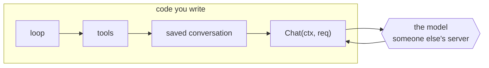

# 01 Talk to the model

**Part I · Wire** · Difficulty: easy-medium · 30 to 50 minutes · 9 graded cases

You write the one function every later chapter calls. It asks a model a question and
puts the reply back together from the pieces it arrives in.

## What you are building

A program that answers a question. Nothing more, yet:

```sh
$ ./agent -p "say something"
The quick brown fox jumps over the lazy dog.
```

The program already exists. It reads the flags, builds the configuration, prints the
answer, and exits. One function is missing, and it is yours:

```go
func (p *OpenAICompat) Chat(ctx context.Context, req Request) (Message, Usage, error)
```

You may edit `agent/provider_openai.go` and nothing else. `agent/types.go` defines the
four types you return, `agent/cmd/agent/main.go` is the program, and `internal/fake/`
is a scripted server you will meet below.

## How it works

**The model is not yours.** Everything after this chapter lives in code you control:
your tools, your loop, your saved conversations, your token budget. This is the only
chapter where you talk to a service somebody else runs. It answers differently every
time. It goes down when their server is busy. Each reply costs money. You cannot write
a test that says "the model will say this".

So the first thing you build is the boundary between their service and your code. One
function, `Chat`, that takes a request and returns a reply. Everything on your side of
that boundary behaves the same way twice, so it can be tested. Nothing on their side
can.



**What you send** is not a sentence. It is a model name, a list of messages in order,
each with a role, and (from chapter 02) a list of tools. For now, one user message.

**What comes back** is the part that surprises people. Not one object. Dozens of small
messages, each holding a few words, and your job is to stick them back together in
order.

The server sends pieces because generating an answer takes seconds, and because it does
not know in advance how long the answer will be. So it sends each new word as soon as it
has it.

```
   you ─────────────────────────────▶  (server writes the answer one word at a time)
   ◀──── data: {"choices":[{"delta":{"content":"The "}}]}    ← 1st piece
   ◀──── data: {"choices":[{"delta":{"content":"quick "}}]}  ← 2nd piece
   ◀──── data: {"choices":[{"delta":{"content":"fox."}}]}    ← 3rd piece
   ◀──── data: {"usage":{...}}                               ← the counts
   ◀──── data: [DONE]                                        ← the end marker
```

Read those lines slowly, because the shape is the whole chapter. Each starts with
`data:`, then a small JSON object. The words you want are not at the top of that object.
They are three levels down:

```
   {"choices": [                 ← a list, because a request may ask for
      {"delta": {                ←   several answers at once
         "content": "The "       ← this is the text. one piece of it.
      }}
   ]}
```

`delta` means "the new part". It is never the whole answer. The first piece holds
`"The "`, the second `"quick "`, the third `"fox."`. Join them and you have
`"The quick fox."`. That is what your function does, for every reply, however many
pieces it comes in.

Two smaller things in that stream. The **counts arrive last**, on a message with no text
in it, because the server only knows them once it has finished. And **`[DONE]` is not
JSON**; it means "that is everything". Parse it and your program crashes on a perfectly
healthy reply.

**Three things will bite you.** Overwriting instead of adding (`msg.Content = piece`
instead of `+=`), which works on a one-piece reply and silently returns `"fox."` on a
real one. Ignoring a broken connection, where the scanner stops and remembers why in
`scanner.Err()`, and you return half an answer as though it were complete. Throwing away
the caller's context, which works perfectly until somebody tries to cancel the request,
three chapters from now.

**The fake server is not cheating.** `internal/fake` is a real HTTP server. It opens a
real socket, reads your request, checks your headers, and writes the same `data:` lines
a real provider writes, ending with the same `[DONE]`. Only the words are fixed, and
those are the one thing a test could never control. Point the same code at Ollama and
the only change is the base URL.

## What you need to send, exactly

`POST {BaseURL}/chat/completions`, with `"stream": true` in the body. Leave that field
out and the server sends one big reply while your parser waits forever.

The reply is `text/event-stream`: lines starting with `data:`, each holding one JSON
object in the shape above. The text is at `choices[0].delta.content`. Not at the top.
The `usage` field appears once, on the last message, which has no text in it.

| Variable | What it is | Default |
|---|---|---|
| `OPENAI_BASE_URL` | the server address, ending in `/v1` | `http://localhost:11434/v1` |
| `OPENAI_API_KEY` | the password the server expects | empty |
| `HARNESS_MODEL` | which model to ask for | `gpt-4o-mini` |
| `HARNESS_DEBUG` | set it to anything to print token counts to stderr | not set |

## How you are checked

The verifier builds your program, starts a real HTTP server that replays a fixed
conversation, points `OPENAI_BASE_URL` at it, and runs your binary. Then it reads what
your program printed, its exit code, and the request it sent. Nothing calls your code
directly.

- `prints-reply`: stdout is the full text plus one newline, exit 0, even when the reply
  arrives in several pieces.
- `request-shape`: the request goes to `/v1/chat/completions`, sends
  `Authorization: Bearer <key>`, uses the model from `-m`, sets `"stream": true`, and
  sends the messages in order.
- `request-envelope`: `Content-Type: application/json` and `Accept: text/event-stream`
  are set.
- `optional-zero-values`: with no token limit or temperature given, those keys are left
  out of the body instead of sent as zero.
- `sse-framing`: comment lines, `event:` lines, CRLF endings, and `data:` with no space
  are all still understood.
- `debug-usage`: with `HARNESS_DEBUG=1`, the counts go to stderr and stdout holds only
  the answer.
- `http-error`: a 429 exits 1, prints nothing to stdout, and mentions the status on
  stderr.
- `truncated-stream`: a connection that dies halfway exits 1 with an error.
- `request-timeout`: with `-timeout 50ms` and a server that never answers, the program
  gives up quickly and exits 1.

**Three of these only fail for code that looks right.** A reply in one piece passes
whether you overwrite or add. A server that answers instantly passes whether or not you
pass the context along. Test with a long reply and a slow server.

## If you get stuck

<details><summary>First hint: what kind of problem is this?</summary>

Three separate things can go wrong, and each has its own check: the request you send,
the way you put the pieces back together, and what you do when something fails. Work out
which one you are in before reading further.
</details>

<details><summary>Second hint: the tools you will need</summary>

`http.NewRequestWithContext` to build the request with the caller's context.
`json.Marshal` for the body. `bufio.Scanner` to read lines, with a larger buffer than
the default. `strings.Builder` to collect the text. `io.LimitReader` to avoid reading a
giant error page.

A scanner gives you lines, not events. The blank lines between events can be skipped.
</details>

<details><summary>Third hint: what the finished function does</summary>

Build the body, POST it with the context you were given. Check the status code before
reading the body; if it is not 200 to 299, read a few KiB and return
`&agent.HTTPError{Status, Body}`.

Otherwise read line by line. Keep the lines starting with `data:`, skip `[DONE]`, and
decode each into a struct with `Choices[].Delta.Content` and a `Usage`. Add each piece
of text to a `strings.Builder`, and remember the usage when it appears.

After the loop, check `scanner.Err()` and return it if it is not nil. Then build the
message from what you collected.

`kata hint 01 <case-id>` prints these same three hints in the terminal.
</details>

## Done when

`kata submit 01` reports 9/9, and `./agent -p "hello"` works against Ollama or any
OpenAI-compatible server. You should also be able to explain, without looking, why
ignoring `scanner.Err()` is dangerous.

When it passes, [example.md](example.md) shows the finished code with the reasons behind
each decision. Read it then, not before.

---

Next: **02 Tool calling**, where the model starts asking you to read files.
