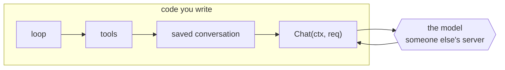
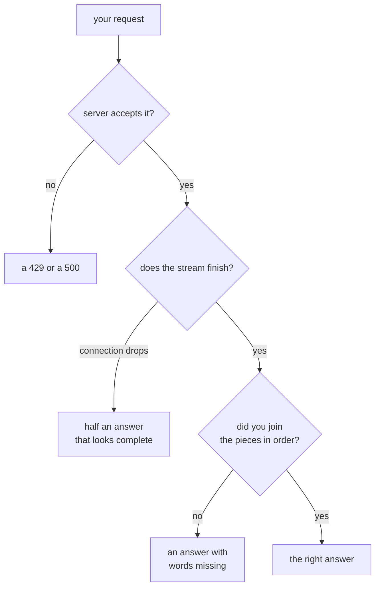

# 01 Overview

*How this chapter works. Read it before you write code. There is no code in it on
purpose.*

---

## Why this is the first chapter

Every chapter after this one is about code you control. Your tools, your loop, your
saved conversations, your token budget. This is the only chapter where you talk to
something you do not control.

The model is a web service somebody else runs. It replies differently every time you
ask the same question. It goes down when their server is busy. Each reply costs money.
You cannot write a test that says "the model will say this", because it will not.

So the first thing you build is the boundary between their service and your code. One
function, called `Chat`, that takes a request and returns a reply.



```
   yours: same every time             │  not yours: different every time,
   ──────────────────────────────────┼──────────────────────────────
   loop → tools → history → Chat ────┼──▶ model ──▶ back through Chat
```

Everything on your side of that arrow can be tested, because it behaves the same way
twice. Nothing on the other side can. That is why you build the boundary first, and
why the rest of the course lives on your side of it.

## What you send

Not a sentence. A small set of named fields:

```
Request
├── model        "gpt-4o-mini"          which model to use
├── messages     [ {system, "..."},     the conversation so far,
│                  {user, "..."} ]       oldest first, each with a role
├── tools        []                     empty in this chapter
└── stream       true                   see below
```

You will fill in `tools` in chapter 02 and add to `messages` in every chapter after
that. For now, one user message is enough.

## What comes back

This is the part that surprises people. The reply does not arrive as one object. It
arrives as **dozens of small messages, each holding a few words**, and your job is to
stick them back together in order.

### Why the reply is sent in pieces

Two reasons.

**Waiting.** Generating an answer takes a few seconds. If the server waited until it
had the whole thing before sending anything, you would stare at a blank screen. So it
sends each new word as soon as it exists, and the user sees the answer being typed.

**Size.** The server does not know in advance how long the answer will be. It might be
one sentence or forty pages. Sending pieces avoids promising a length it cannot keep.

```
   you ─────────────────────────────────▶  (server writes the answer
                                            one word at a time)
   ◀──── data: {"choices":[{"delta":{"content":"The "}}]}    ← 1st piece
   ◀──── data: {"choices":[{"delta":{"content":"quick "}}]}  ← 2nd piece
   ◀──── data: {"choices":[{"delta":{"content":"fox."}}]}    ← 3rd piece
   ◀──── data: {"usage":{...}}                               ← the counts
   ◀──── data: [DONE]                                        ← the end marker
```

Read those lines slowly, because the shape is the whole chapter. Each line starts with
`data:`. After that is a small JSON object. The words you want are not at the top of
that object. They are three levels down:

```
   {"choices": [                 ← a list, because a request may ask for
      {"delta": {                ←   several answers at once
         "content": "The "       ← this is the text. one piece of it.
      }}
   ]}
```

`delta` means "the new part". It is never the whole answer. The first piece holds
`"The "`, the second holds `"quick "`, and the third holds `"fox."`. Put those three
together and you have `"The quick fox."`. That is what your function has to do, for
every reply, no matter how many pieces it comes in.

Two smaller things in that stream:

**The counts arrive last.** `prompt_tokens` and `completion_tokens` tell you how much
the call cost. The server only knows them once it has finished writing, so they come at
the end, on a message with no text in it.

**`[DONE]` is not JSON.** It is the server saying "that is everything". It has no reply
and no content. If you try to parse it as JSON, your program crashes on a perfectly
healthy reply.

## Three things that will bite you

The rest of this page is about failure, because a client like this fails in ways that
look like success.



**Overwriting instead of adding.** The most common first bug. You write
`msg.Content = piece` instead of `msg.Content += piece`. On a one-piece reply it works
perfectly. On a real reply you keep only the last piece, so a long answer arrives as
`"fox."`. Your program exits 0 and looks happy, which is what makes it nasty.

**Ignoring a broken connection.** When the connection drops halfway, the Go scanner
stops reading and remembers why in `scanner.Err()`. If you never check it, the half
answer you collected is returned as though it were complete. The program says
`"The quick "` and thinks it succeeded. Always check the error after the loop.

**Throwing away the caller's context.** Use `context.Background()` and the request
still works. It works today, it works tomorrow, and it works for every case except the
one where somebody tries to cancel the request. That is chapter 08, three chapters
later, where Ctrl-C silently does nothing and the bug looks brand new. Pass the
`ctx` you were given, and cancellation works from the start.

| What goes wrong | The wrong version | Where it is caught |
|---|---|---|
| words overwritten | `=` instead of `+=` | `prints-reply` |
| wrong field | reading `delta` at the top level | `prints-reply`, `sse-framing` |
| dropped connection | skipping `scanner.Err()` | `truncated-stream` |
| counts missing | only decoding messages with text | `debug-usage` |
| bad request | no `"stream": true`, wrong URL | `request-shape`, `request-envelope` |
| no cancellation | `context.Background()` | `request-timeout` |
| any error at all | decoding the error page as a reply | `http-error` |

## Why the fake server is not cheating

The course hands you `internal/fake`, a small server that replays fixed replies. It is
reasonable to suspect that you are not really talking to a model, so the chapter is not
really about anything.

The opposite is true. `internal/fake` is a real HTTP server. It opens a real socket,
reads your request, checks your headers, and writes the same `data:` lines a real
provider writes, in the same broken-up way, ending with the same `[DONE]`. The only
thing it replaces is the words. That is the one thing a test could never control
anyway.

When you point this same code at Ollama on your laptop, the only change is the base
URL. Nothing else, because the protocol was never the fake's, it was the provider's.

This is how every real agent tests itself. You will do it again for tools, for saved
conversations, and for the subagent.

## Where real clients go further

| What they add | In pi | In crush |
|---|---|---|
| retries with backoff | `packages/ai/src/api/openai-completions.ts` | `internal/agent/request_timeout.go` |
| prompt caching | `openai-prompt-cache.ts` | none |
| about thirty other providers | `packages/ai/src/providers/` | `internal/backend/` |

All of them keep the shape you are about to write. The extra code is years of
production problems, not a different design. Read `openai-completions.ts` after you
pass, and see how much of it you recognise.

## Check yourself

Answer these without scrolling up. The section that answers each is in brackets.

1. Why does the reply arrive in pieces instead of one object? *(Why the reply is sent
   in pieces)*
2. Where in the JSON does the actual text live, and why is it not at the top?
   *(Why the reply is sent in pieces)*
3. Why can the cost counts not arrive on the first message? *(Why the reply is sent in
   pieces)*
4. Your agent answers a long question with just `"fox."`. What did you do wrong, and
   why did the program still exit successfully? *(Three things that will bite you)*
5. Why does `context.Background()` look fine for the next three chapters?
   *(Three things that will bite you)*
6. Name one thing the fake server replaces and one thing it does not. *(Why the fake
   server is not cheating)*
