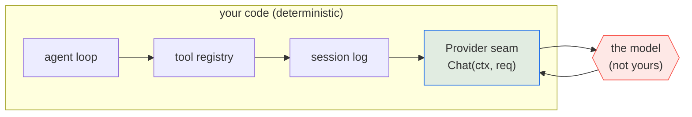
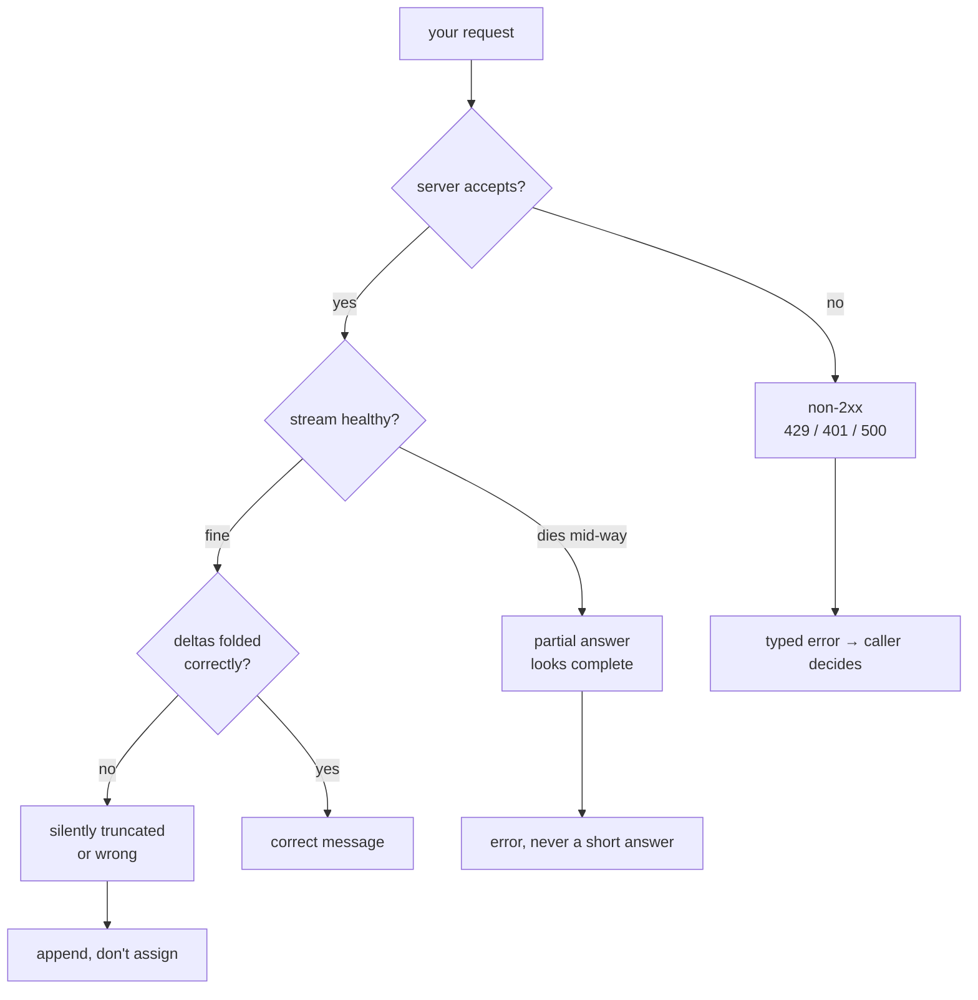

# 01 — Overview

*How this mechanism works, in general. Read this before you write code; it is
deliberately free of implementation detail.*

---

## Why this is chapter one

Every harness is a loop around a function that talks to a model. That function
is the only part of the system that is not yours: it fails on someone else's
schedule, costs money per call, answers differently every time, and is
impossible to test.

So you put a seam around it on day one. Not as a design flourish — as the thing
that makes the next ten chapters gradable at all.



```
   yours: deterministic                │  not yours: random, slow, paid
   ────────────────────────────────────┼──────────────────────────────────
   loop → tools → session → provider ──┼──▶ model ──▶ back through provider
```

Above the seam you can assert anything. Below it, nothing. So the first thing
you build is the seam, and the first thing you learn is what crosses it.

## What actually crosses the seam

Not "a prompt". A structure. An OpenAI-compatible request is a model name, an
ordered list of messages with roles, and optionally a list of tool definitions:

```
Request
├── model        "gpt-4o-mini"
├── messages     [ {system, "..."}, {user, "..."} ]
├── tools        []            ← empty in this chapter
└── stream       true
```

The response is not a structure. It is a **sequence of partial structures**, and
reassembling it is the chapter.

### Why the wire is a stream

Two reasons, and only the second is obvious.

1. **Latency.** The user sees the first token in ~200 ms instead of waiting for
   the whole answer.
2. **Length.** A response can be longer than any single HTTP chunk can
   comfortably carry, and the server does not know in advance how long it will
   be.

So the server emits `text/event-stream`: a plain-text framing of "here is a bit
more". Each bit is a JSON object with a *delta*, meaning "the part that is new".

```
   request ──────────────────────────────▶
                                            (server builds the answer
                                             one token at a time)
   ◀──── data: {"delta":{"content":"The "}}          ← chunk 1
   ◀──── data: {"delta":{"content":"quick "}}        ← chunk 2
   ◀──── data: {"delta":{"content":"fox."}}          ← chunk 3
   ◀──── data: {...,"usage":{...}}                   ← chunk 4 (metadata only)
   ◀──── data: [DONE]                                ← terminator
```

The mental model to hold: **the stream is a delta log, and your job is to fold
it.** Every chunk is an event, not a document. Nothing in the stream is the
complete answer; the complete answer is what you get by applying all the deltas
in order.

Once you see it that way, three properties stop being trivia and become obvious:

- **Append, never assign.** Folding is an accumulation.
- **Metadata arrives late.** Usage is only known once the server has finished
  producing the answer, so it rides on the final chunk, whose `delta` is empty.
- **The terminator is not data.** `[DONE]` is framing, not a message.

## Why the failure modes cluster here

A provider client has an unusually bad ratio of code to failure modes, because it
sits on a network boundary with three independent clocks: yours, the server's,
and the connection's.



Each branch is a graded case, and each one has a plausible-looking wrong
implementation:

| Branch | The wrong implementation | The case |
|---|---|---|
| non-2xx | decode the error body as a completion | `http-error` |
| stream dies | ignore `scanner.Err()` | `truncated-stream` |
| deltas | assign instead of append | `text-reassembly` |
| metadata | only decode chunks that carry content | `usage` |
| request | forget `stream: true`, or build the URL by hand | `request-shape` |
| lifetime | use `context.Background()` instead of `ctx` | `context-cancel` |

That last one deserves a note: `context.Background()` *works*. The request
succeeds. It only fails when someone tries to cancel you — which is exactly what
chapter 08 (steering and abort) does, and by then the bug is three chapters old
and invisible.

## Why the scripted server is not a cheat

It would be easy to think "they gave me a fake server, so I'm not really talking
to a model". The opposite is true.

`internal/fake` is a real HTTP server. It binds a socket, parses your request,
validates your headers, and writes real SSE bytes with real chunk boundaries and
a real `[DONE]`. The only thing replaced is the *content* of the reply — which
is the one thing a test can never control and never needs to. When you point
this same client at Ollama and it works, nothing changes but the base URL,
because the protocol was the protocol.

This is the course's central trick, stated plainly: **replace the model, keep
the wire.** That is how every harness in the world tests itself, and you will do
it again for tools, sessions, and subagents.

## Where the real implementations go further

| Concern | pi | crush |
|---|---|---|
| Retries / backoff | `packages/ai/src/api/openai-completions.ts` | `internal/agent/request_timeout.go` |
| Prompt caching | `openai-prompt-cache.ts` | — |
| Provider fan-out (~30 wire formats) | `packages/ai/src/providers/` | `internal/backend/` |

They all keep the same shape you are about to write. The extra code is
accumulated scar tissue from production, not a different architecture. Read
`openai-completions.ts` *after* you pass, and notice how much of it you now
recognise.

## Self-check

Answer these without scrolling up. If you can't, re-read the section named.

1. Why is `[DONE]` not a message? *(Why the wire is a stream)*
2. Usage is reported once. Why can it not be reported on the first chunk?
   *(Why the wire is a stream)*
3. Name the six failure branches and which one is invisible until chapter 08.
   *(Why the failure modes cluster here)*
4. What exactly is replaced when the scripted server stands in for a model, and
   what is not? *(Why the scripted server is not a cheat)*
5. Why does `assign` instead of `append` pass a naive test? *(The failure table)*
