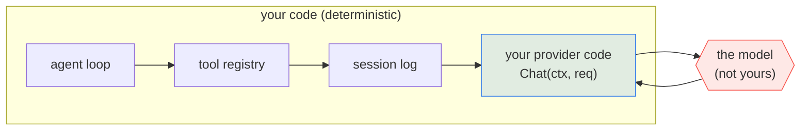
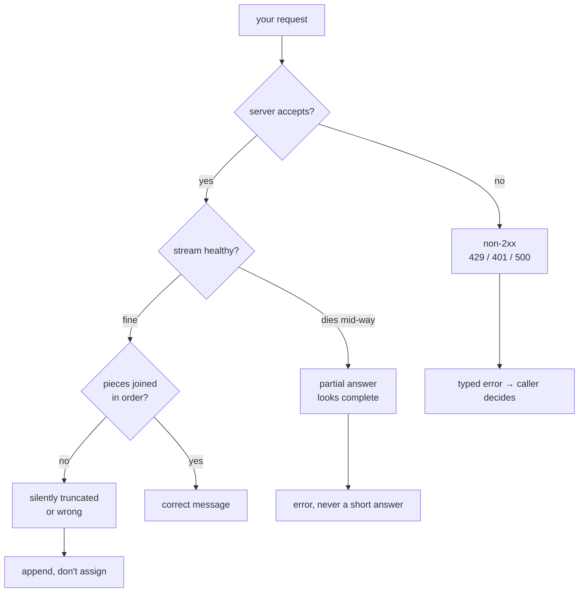

# 01 Overview

*How this mechanism works, in general. Read this before you write code; it is
deliberately free of implementation detail.*

---

## Why this is chapter one

This is the only page of the course where you talk to something you do not control.

Everything after this chapter is yours: your tools, your loop, your session file, your
budget. The model is not. It answers differently every time you ask, it fails when
someone else's server is busy, and each answer costs money. You cannot write a test
against it.

That is the problem worth solving first, because every later chapter needs it solved.
Put the model behind one function, and everything above that function becomes
predictable enough to check. Not as a design flourish: it is what makes the next
eleven chapters gradable at all.



```
   yours: deterministic                │  not yours: random, slow, paid
   ────────────────────────────────────┼──────────────────────────────────
   loop → tools → session → provider ──┼──▶ model ──▶ back through provider
```

On your side of that line you can check anything. On the model's side, nothing. So the
first thing you build is the line itself, and the first thing you learn is what travels
across it.

## What travels across the line

Not a prompt string. A structure: a model name, a list of messages in order, each with
a role, and sometimes a list of tools:

```
Request
├── model        "gpt-4o-mini"
├── messages     [ {system, "..."}, {user, "..."} ]
├── tools        []            ← empty in this chapter
└── stream       true
```

The response is not a structure. It arrives as **many small pieces**, and putting them
back together is what this chapter is about.

### Why the wire is a stream

Two reasons, and only the second is obvious.

1. **Latency.** The user sees the first token in ~200 ms instead of waiting for
   the whole answer.
2. **Length.** A response can be longer than any single HTTP chunk can
   comfortably carry, and the server does not know in advance how long it will
   be.

So the server sends `text/event-stream`: plain text, one small JSON object at a time,
each one saying "here is a bit more". The `delta` field inside holds only the new piece,
not the whole answer so far.

```
   request ──────────────────────────────▶
                                            (server builds the answer
                                             one token at a time)
   ◀──── data: {"choices":[{"delta":{"content":"The "}}]}    ← chunk 1
   ◀──── data: {"choices":[{"delta":{"content":"quick "}}]}  ← chunk 2
   ◀──── data: {"choices":[{"delta":{"content":"fox."}}]}    ← chunk 3
   ◀──── data: {...,"usage":{...}}                          ← chunk 4
   ◀──── data: [DONE]                                       ← terminator
```

The text sits two levels down: one message can carry several **choices**, and each
choice has its own `delta`. That nesting is easy to misremember, so here is the exact
shape to decode into:

```json
{
  "choices": [
    { "index": 0, "delta": { "content": "The " }, "finish_reason": null }
  ],
  "usage": { "prompt_tokens": 42, "completion_tokens": 7, "total_tokens": 49 }
}
```

The `choices` array exists because a request can ask for several completions. This
course asks for one, sends no `n`, and reads `choices[0]`. If a stream did carry
several choices, adding them all together would mix up separate answers.

Here is the idea to hold on to. **The stream is a list of pieces, and your job is to
stick them together.** No single message is the answer. The answer is what you get by
joining every piece in order.

Once you see it that way, three things stop being surprising:

- **Add to the end, never overwrite.** Joining means keeping what you already have.
- **The token counts come last.** The server only knows them once it has finished, so
  they arrive on the final message, which has no text in it.
- **`[DONE]` is not data.** It marks the end of the stream. It is not part of the
  answer.

## Why the failure modes cluster here

A provider client has an unusually bad ratio of code to failure modes, because it
sits on a network boundary with three independent clocks: yours, the server's,
and the connection's.



Each branch is a graded case, and each one has a plausible-looking wrong
implementation:

| Branch | The wrong implementation | The case |
|---|---|---|
| non-2xx | decode the error body as a completion | `http-error` |
| stream dies | ignore `scanner.Err()` | `truncated-stream` |
| pieces of text | overwrite instead of add | `prints-reply` |
| shape | read `delta` from the top level instead of `choices[0].delta` | `prints-reply`, `sse-framing` |
| metadata | only decode chunks that carry content | `debug-usage` |
| request | forget `stream: true`, or build the URL by hand | `request-shape`, `request-envelope` |
| lifetime | use `context.Background()` instead of `ctx` | `request-timeout` |

That last one deserves a note: `context.Background()` *works*. The request
succeeds. It only fails when someone tries to cancel you, which is exactly what
chapter 08 (steering and abort) does, and by then the bug is three chapters old
and invisible.

## Why the scripted server is not a cheat

It would be easy to think "they gave me a fake server, so I'm not really talking
to a model". The opposite is true.

`internal/fake` is a real HTTP server. It binds a socket, parses your request,
validates your headers, and writes real SSE bytes with real chunk boundaries and
a real `[DONE]`. The only thing replaced is the *content* of the reply, which
is the one thing a test can never control and never needs to. When you point
this same client at Ollama and it works, nothing changes but the base URL,
because the protocol was the protocol.

This is the course's central trick, stated plainly: **replace the model, keep
the wire.** That is how every harness in the world tests itself, and you will do
it again for tools, sessions, and subagents.

## Where the real implementations go further

| Concern | pi | crush |
|---|---|---|
| Retries / backoff | `packages/ai/src/api/openai-completions.ts` | `internal/agent/request_timeout.go` |
| Prompt caching | `openai-prompt-cache.ts` | none |
| Provider fan-out (~30 wire formats) | `packages/ai/src/providers/` | `internal/backend/` |

They all keep the same shape you are about to write. The extra code is
accumulated scar tissue from production, not a different architecture. Read
`openai-completions.ts` *after* you pass, and notice how much of it you now
recognise.

## Self-check

Answer these without scrolling up. If you can't, re-read the section named.

1. Why is `[DONE]` not a message? *(Why the wire is a stream)*
2. Usage is reported once. Why can it not be reported on the first chunk?
   *(Why the wire is a stream)*
3. Name the six failure branches and which one is invisible until chapter 08.
   *(Why the failure modes cluster here)*
4. What exactly is replaced when the scripted server stands in for a model, and
   what is not? *(Why the scripted server is not a cheat)*
5. Why does `assign` instead of `append` pass a naive test? *(The failure table)*
