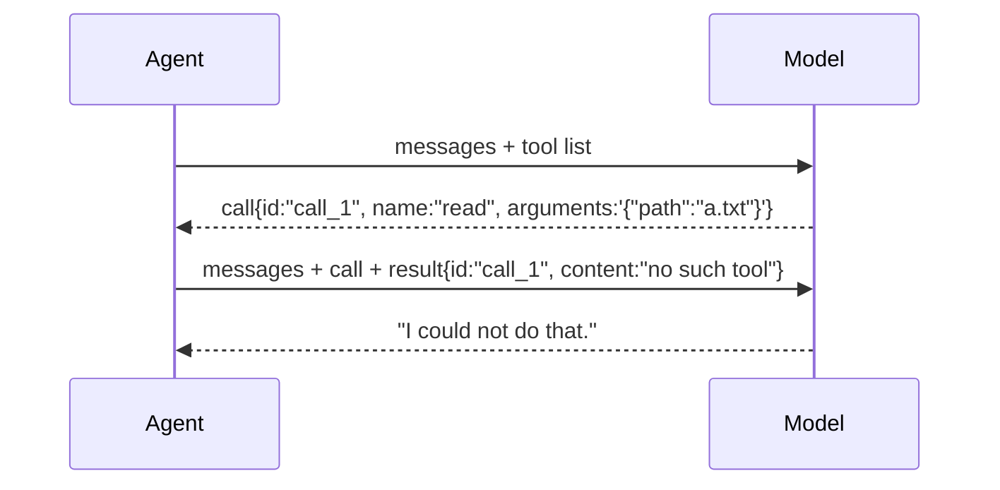

# 02 Tool calling

**Part I · Wire** · Difficulty: medium · 40 to 60 minutes · 6 graded cases

The model can now ask your program to do things. This chapter is only about the
conversation: how a call arrives, how it is grouped, and what to answer when you do not
have the tool it wants. Chapter 03 puts a real file behind it.

## What you are building

A program that survives being asked to run a tool.

```sh
$ ./agent -p "read notes.txt and tell me what it says"
I could not do that.
```

There is no `read` tool yet, so the honest answer is "I cannot do that". The point is
that the program answers instead of crashing, and that the model receives a reply it
can act on.

You may edit `agent/tool.go`, `agent/tools.go` and `agent/provider_openai.go`. The
program in `agent/cmd/agent/main.go` already passes the tool list and runs whatever the
model asks for.

## How it works

A model cannot read a file. It can only produce text. Tool calling works because both
sides agree that certain text is a request:

1. **Advertise.** Your request carries a list of tools: a name, a description, and the
   shape of the arguments.
2. **Call.** The model's reply contains a structured call instead of prose: an id, a
   name, and an arguments string.
3. **Answer.** You send back a message that names the id it answers. Then you ask the
   model again.



**The id is the contract.** A result names the call it answers. A conversation where a
call has no result, or a result has no call, is rejected by every real provider. That is
not a style preference; it is what the protocol requires.

**The arguments arrive in pieces.** The reply streams, so the call streams with it. The
first piece names the call; later pieces carry only the group number and a few
characters of the argument text.

```
  piece 1:  index 0 · id call_1 · name read     the identity arrives once
  piece 2:  index 0 · arguments {"pa           no id, no name
  piece 3:  index 0 · arguments th":"a.
  piece 4:  index 0 · arguments .txt"}
  ──────────────────────────────────────────
  one call, arguments {"path":"a.txt"}
```

Group by the **index**, not by the id. Grouping by id works until the second piece
arrives without one, which is every real provider and every piece after the first.

**A model can also name a tool you do not have.** It will, eventually, because it
guesses. That is not a crash, it is information:

| What arrives | What the model should receive |
|---|---|
| a tool name you do not know | `no such tool: <name>` |
| arguments that are not JSON | `arguments are not valid JSON: ...` |
| a tool that runs and fails | the failure text, marked as an error |

None of those end the program. Each becomes a result, and the model gets one more
chance to do something useful.

## What you need to build

```go
type Registry struct{ /* ... */ }

func NewRegistry(tools ...Tool) *Registry
func (r *Registry) Lookup(name string) (Tool, bool)
func (r *Registry) Defs() []ToolDef
func (r *Registry) Run(ctx context.Context, call ToolCall) ToolResult
```

`Tool` is already declared in `agent/types.go`. The provider also has to learn two
directions of the wire format: an assistant message carrying `tool_calls`, and a
`tool` message carrying `tool_call_id`.

## How you are checked

The verifier builds your program, starts a server that asks for a tool on the first
turn, and runs your binary with a temporary directory as its working directory. Then it
reads both requests and what your program printed.

- `advertises-tools`: the request carries a `tools` array.
- `unknown-tool-is-a-result`: a call to a name you do not have produces
  `no such tool`, and the program still exits 0.
- `invalid-arguments`: a call whose arguments are not JSON produces
  `arguments are not valid JSON`.
- `folds-arguments`: four pieces, with the id only on the first, resolve to one call.
- `result-carries-call-id`: the tool message carries the id of the call it answers.
- `tool-list-comes-from-the-registry`: every tool you advertise can actually be called.

## If you get stuck

<details><summary>First hint: what kind of problem is this?</summary>

Three separate things: what you send, how you group what comes back, and what you
answer when something is wrong. The failing case id tells you which one.
</details>

<details><summary>Second hint: the tools you will need</summary>

`encoding/json` for both directions. A map keyed by an integer for the streamed pieces.
`json.Valid` before decoding arguments the model wrote. `sort.Ints` to emit the calls in
order.
</details>

<details><summary>Third hint: what the finished registry does</summary>

`Lookup` is a map read. `Defs` walks the tools in registration order and returns name,
description and schema. `Run` looks the name up, and returns an error result for an
unknown name, then checks the arguments are valid JSON, then calls the tool and turns a
returned error into an error result.

In the provider, add an accumulator keyed by index. On each piece, set the id and name
when they are present, and always append the argument text. Emit the calls in index
order. When writing a tool message, include `role: "tool"` and `tool_call_id`.

`kata hint 02 <case-id>` prints these same hints in the terminal.
</details>

## Done when

`kata submit 02` reports 6/6, and:

- a model asking for a tool you do not have gets a readable answer;
- four pieces of argument text become one call;
- you can explain why grouping by id fails and grouping by index does not.

When it passes, [example.md](example.md) shows the finished code.

---

Next: **03 Running a tool**, where `read` becomes real and the disk gets involved.
