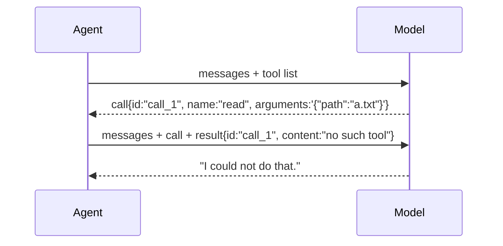

# 02 Tool calling

**Part I · Wire** · Difficulty: medium · 40 to 60 minutes · 7 graded cases

## What you are building

A program that can be asked to run a tool, and answers.

```sh
$ ./agent -p "read notes.txt and tell me what it says"
I could not do that.
```

There is no `read` tool yet, so that is the correct answer. The program has to say so
instead of exiting, and the model has to receive a reply it can act on.

Edit `agent/tool.go`, `agent/tools.go` and `agent/provider_openai.go`.
`agent/cmd/agent/main.go` already sends the tool list and runs whatever the model asks
for.

## The protocol

A model cannot read a file. It produces text. Tool calling works because both sides
agree that some of that text is a request:

1. The request carries a list of tools: name, description, and the shape of the
   arguments.
2. The reply contains a call instead of prose: an id, a name, and an arguments string.
3. You send a message naming the id it answers, then ask the model again.



The id is what pairs the two halves. A call with no result, or a result whose id matches
no call, is a conversation every provider rejects.

## Arguments arrive in pieces

The reply streams, so the call streams with it. The first piece names the call. Later
pieces carry only the group number and a few characters of the argument text.

```
  piece 1:  index 0 · id call_1 · name read     the identity arrives once
  piece 2:  index 0 · arguments {"pa            no id, no name
  piece 3:  index 0 · arguments th":"a.
  piece 4:  index 0 · arguments .txt"}
  ──────────────────────────────────────────
  one call, arguments {"path":"a.txt"}
```

Group by the index. The id is absent from every piece after the first, so a parser keyed
on it loses the arguments.

One message may contain several calls, each with its own index. Results go back in the
same order, each with its own id.

## Calls you cannot answer

A model will name a tool that does not exist, because it guesses. Each of these becomes
a result, and the program continues:

| What arrives | What the model receives |
|---|---|
| a name you do not know | `no such tool: <name>` |
| arguments that are not JSON | `arguments are not valid JSON: ...` |
| a tool that runs and returns an error | the failure text, marked as an error |

## What you need to build

```go
type Registry struct{ /* ... */ }

func NewRegistry(tools ...Tool) *Registry
func (r *Registry) Lookup(name string) (Tool, bool)
func (r *Registry) Defs() []ToolDef
func (r *Registry) Run(ctx context.Context, call ToolCall) ToolResult
```

`Tool` is declared in `agent/types.go`. The provider gains two directions of wire
format: an assistant message carrying `tool_calls`, and a `tool` message carrying
`tool_call_id`.

## How you are checked

The verifier builds your program, starts a server that asks for a tool on the first
turn, and runs your binary in a temporary directory. It reads both requests and what
your program printed.

- `advertises-tools`: the request carries a `tools` array.
- `unknown-tool-is-a-result`: a call to a name you do not have produces
  `no such tool`, and the program exits 0.
- `invalid-arguments`: arguments that are not JSON produce `arguments are not valid
  JSON`.
- `folds-arguments`: four pieces, id only on the first, become one call.
- `two-calls-in-one-message`: two calls arriving together keep their own arguments, so
  index 0 and index 1 do not merge.
- `result-carries-call-id`: the tool message carries the id of the call it answers.
- `tool-list-comes-from-the-registry`: every advertised tool can actually be called.

## If you get stuck

<details><summary>First hint: the shape of the problem</summary>

Either the request is wrong, the pieces are grouped wrongly, or a bad call is treated as
a fatal error. The failing case id names which.
</details>

<details><summary>Second hint: what you will need</summary>

`encoding/json` for both directions. A map keyed by an integer for the streamed pieces.
`json.Valid` on arguments the model wrote. `sort.Ints` to emit calls in order.
</details>

<details><summary>Third hint: the finished registry</summary>

`Lookup` is a map read. `Defs` walks the tools in registration order and returns name,
description and schema. `Run` looks the name up, returns an error result when it is
missing, checks the arguments are valid JSON, calls the tool, and turns a returned error
into an error result.

In the parser, accumulate by index: set the id and name when present, always append the
argument text, emit in index order. A tool message needs `role: "tool"` and
`tool_call_id`.

`miyagi hint 02 <case-id>` prints the same three hints.
</details>

## Done when

`miyagi submit 02` reports 7/7, and a model asking for a tool you do not have receives a
readable answer.

[example.md](example.md) has the finished code, after you pass.

---

Next: **03 Running a tool**.
