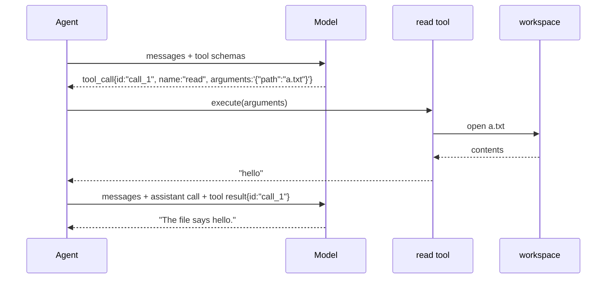

# 02 Overview

*How tool calling works, in general. Read this before you write code.*

---

## The protocol has three moves

A model cannot read a file. It can only produce text. Tool calling works because
both sides agree that certain text is a request:

1. **Advertise.** The request carries a list of tool schemas: a name, a
   description, and the shape of the arguments.
2. **Call.** The model's reply contains a structured call instead of prose: an
   id, a name, and an arguments string.
3. **Return.** The client runs the tool and appends a message that names the id
   it answers. Then it asks the model again.



The pairing is the contract. A tool result carries the id of the call it answers,
and providers reject a conversation where a call has no result or a result has no
call. Everything else in this chapter follows from that rule.

## Why the arguments arrive in pieces

The reply streams, so the call streams with it. The first fragment for a call
carries its index, id and name. Later fragments carry **only the index and a
piece of the arguments string**:

```
data: {"choices":[{"delta":{"tool_calls":[{"index":0,"id":"call_1","type":"function","function":{"name":"read","arguments":""}}]}}]}
data: {"choices":[{"delta":{"tool_calls":[{"index":0,"function":{"arguments":"{\"pa"}}]}}]}
data: {"choices":[{"delta":{"tool_calls":[{"index":0,"function":{"arguments":"th\":\"a."}}]}}]}
data: {"choices":[{"delta":{"tool_calls":[{"index":0,"function":{"arguments":"txt\"}"}}]}}]}
```

```
  fragment 1:  index 0 · id call_1 · name read      ← identity
  fragment 2:  index 0 · arguments `{"pa`           ← no id, no name
  fragment 3:  index 0 · arguments `th":"a.`
  fragment 4:  index 0 · arguments `txt"}`
                                                    ────────────────
  result:      one call, arguments `{"path":"a.txt"}`
```

Folding by **index** is the only reliable rule. Folding by id works until the
second fragment arrives with an empty id, which is every real provider.

A model may also return several calls in one message. Each has its own index, and
the results must be returned in the same order.

## Failure is a result, not an exception

The model's arguments are text it wrote, so they can be wrong. A path can be
missing, a file can be huge, a path can climb out of the workspace, and the JSON
itself can be malformed.

None of those should end the program. Each becomes a tool result with an error
flag, so the model can read the message and try something else:

| Situation | Result the model sees | Program |
|---|---|---|
| file missing | `no such file: nope.txt` | continues, exit 0 |
| arguments malformed | `arguments are not valid JSON: {"path":` | continues, exit 0 |
| path escapes the workspace | `path escapes the workspace: ../../etc/passwd` | continues, exit 0 |
| file larger than the limit | first 20,000 bytes + a truncation marker | continues, exit 0 |

The exception is a broken request to the provider, which is not the model's
fault and cannot be repaired by asking again.

## Two things the model cannot do

**It cannot see the workspace.** Everything it knows about a file comes from a
tool result. That is why a truncation marker matters: without it, the model
believes it read the whole file and will answer confidently about the part it
never saw.

**It cannot recover from a silent failure.** A tool that returns an empty string
on error teaches the model that the file is empty. Say what happened.

## Where this chapter stops

This program makes **one** hop: call, run tools, ask once more, print. If the
model asks for a second tool after the first result, the program prints whatever
text came with that request and stops.

That limit is deliberate. Chapter 04 replaces the hop with a loop, and the
difference between the two is easier to see when you have written the hop.

## Where the real implementations go further

| Concern | pi | crush |
|---|---|---|
| Parallel tool execution | `packages/agent/src/agent-loop.ts` | `internal/agent/coordinator.go` |
| Blocking a call before it runs | `beforeToolCall` in `agent/types.ts` | `internal/permission/` |
| Schema generation | TypeBox | `internal/agent/agent_tool.go` |

They keep the same three moves. The extra code is policy, not protocol.

## Self-check

1. Which field identifies a call, and which field groups its fragments?
   *(Why the arguments arrive in pieces)*
2. A tool result is missing its `tool_call_id`. What does the provider do?
   *(The protocol has three moves)*
3. Why does a truncation marker change the model's answer quality?
   *(Two things the model cannot do)*
4. Name three failures that must become results rather than exits.
   *(Failure is a result, not an exception)*
5. What does the program do if the second reply also asks for a tool?
   *(Where this chapter stops)*
