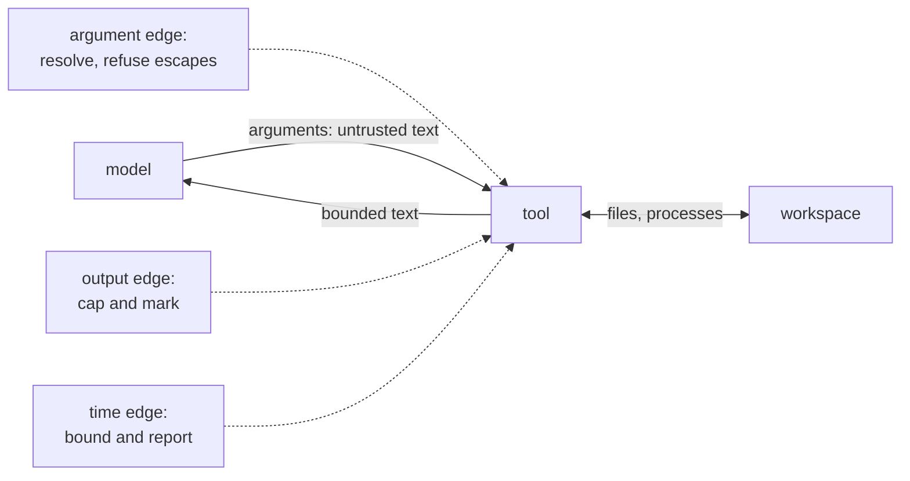

# 03 Overview

*How tools that touch disk work, and what can go wrong. Read this before you
write code.*

---

## A tool is a capability, and capabilities have edges

`read` takes a path and returns text. `write` takes a path and text. `bash` takes
a command line. Each looks like a function call. Each has three edges you have to
decide about before you write it:

| Edge | Question | Wrong answer |
|---|---|---|
| Arguments | whose input is this? | treat it as trusted |
| Output | how much can come back? | return all of it |
| Time | how long can it take? | wait forever |

The model writes the arguments, so they are attacker-controlled input from your
program's point of view. The machine writes the output, so it can be larger than
the context window. The command decides the duration, so it can outlive the
conversation.



## The workspace boundary

Every path is resolved against a workspace root and refused if it escapes.
Two rules make it hold:

1. Resolve first, then check. `a/../../etc/passwd` contains `..`, but so do
   legitimate names, and a symlink defeats any string check.
2. Refuse absolute paths outright. The model has no reason to name one, and
   allowing it makes the check conditional on the machine.

```
  requested:  ../../etc/passwd
  joined:     /workspace/../../etc/passwd
  resolved:   /etc/passwd
  relative:   ../../etc/passwd          ← starts with .., refused
```

The same helper serves `read` and `write`. A write escape is worse than a read
escape: it changes the machine.

## Exit codes are results

A shell command that exits 3 has done something normal. The model asked for an
operation, the operation reported failure, and the model can now decide what to do
about it.

So `bash` returns text:

```
exit code: 3
before
```

and the program keeps going. Only two things are errors: the process could not
start, and the user cancelled. Both mean the conversation cannot continue
meaningfully.

| Outcome | Result | Go error |
|---|---|---|
| exit 0 | `exit code: 0` plus output | none |
| exit 3 | `exit code: 3` plus output | none |
| output too long | capped plus marker | none |
| tool timeout | `command timed out after 10s` | none |
| user pressed Ctrl-C | none | `context.Canceled` |
| `sh` not found | none | start error |

## Two bounds, and they are not the same

```
  -timeout        bounds one provider request      (chapter 01)
  -tool-timeout   bounds one tool execution        (this chapter)
```

They are separate because they fail differently. A slow model should not consume
the budget for running a test suite, and a long test suite should not look like a
slow model. Both arrive through a context, so both are cancellable, but one is the
caller's decision and the other is the tool's.

## The truncation rule

An unbounded output costs more than tokens. It costs the model's understanding
of position: with 200 KB of log in the middle of the conversation, the important
instruction from the first message is proportionally invisible.

So cap, and say what you capped:

```
... [truncated: 20000 of 184320 bytes shown]
```

A silent cap is worse than no cap, because the model will reason about the part
it thinks it saw.

## A known limitation, stated plainly

`exec.CommandContext` kills the process it started. It does not reliably kill
that process's children. A command like `sh -c "sleep 100 &"` can leave a
background process behind.

Fixing it properly means process groups, which is platform-specific: on Unix,
`Setpgid` plus a negative-pid kill; on Windows, a job object. That is a chapter of
its own, so this course states the limitation and moves on. Chapter 08 adds
cancellation for the request; the process-group gap stays documented in "where
next".

## Where the real implementations go further

| Concern | pi | crush |
|---|---|---|
| Permission policy before a tool runs | `beforeToolCall` hook | `internal/permission/` |
| Process groups and sandboxing | platform-specific | `internal/shell/` |
| Output handling | truncation with handles | `internal/fsext/` |

The three edges are the same everywhere. What they add is policy: who is allowed to run
what. That arrives in chapter 08.

## Self-check

1. Why is resolving before checking safer than scanning the string for `..`?
   *(The workspace boundary)*
2. A command exits 3. What does the model receive, and what does the program
   return? *(Exit codes are results)*
3. Why are the request timeout and the tool timeout separate?
   *(Two bounds, and they are not the same)*
4. Why is a silent truncation worse than a visible one?
   *(The truncation rule)*
5. Name the case that would break if you killed only the direct child process,
   and explain why this chapter does not grade it.
   *(A known limitation, stated plainly)*
