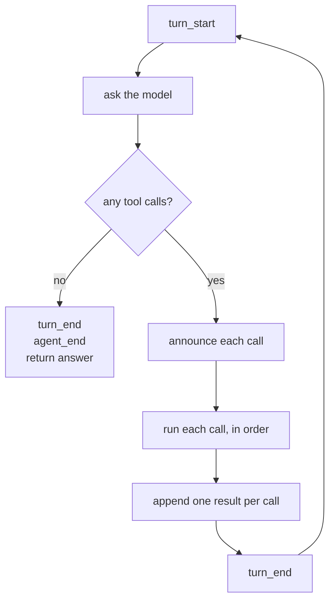
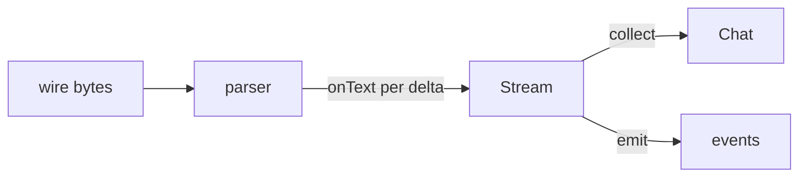

# 04 Overview

*How a loop works, and what it means to observe one. Read this before you write
code.*

---

## One hop is not a loop

The previous chapter asked the model, ran the tools, asked once more, and
printed. That works for "read this file". It fails for "find every TODO", which
needs: list files, read one, read another, grep, then answer. Each of those is a
turn, and the number of turns is not known in advance.

So the shape changes from a straight line to a loop with one exit condition:



Two things about that diagram matter more than the rest.

**The exit condition is the reply, not a counter.** A program that loops "until
the model produces no tool calls" is correct; a program that loops "five times"
is a different program that happens to work sometimes.

**The counter is still there, as a ceiling.** Those are not in conflict. Exit when
the model stops; stop anyway after N turns and say so.

```
  correct:   while the model asks for tools: do a turn
  safe:      ...and never more than N turns
  wrong:     do exactly N turns
```

## The step cap is not optional

A model that keeps asking for a tool is not a hypothetical. It happens when the
tool keeps failing, when the instruction is ambiguous, and when the model is
small. Without a cap, the program runs until the account is empty.

Some harnesses default the cap to zero, meaning unbounded. Do not copy that. A
positive default, plus a clear stop reason, turns an endless run into a
diagnosable failure:

```
$ agent -p "loop forever" -max-steps 3
agent: step limit reached after 3 turns; the model kept asking for tools
$ echo $?
1
```

Exit 1, because the task did not finish. Printing a partial answer with exit 0
would tell the caller that everything went well.

## Order is part of the contract

A single assistant message can ask for several tools at once. They form one batch,
and the results must return **in the order the model asked for them**, each with
its own id.

```
  assistant:  call_a(read a.txt)   call_b(read b.txt)
  results:    call_a → "alpha"     call_b → "beta"        ← same order
```

The model asked in that order and reads the answers in that order. Providers also
validate the pairing: a result whose id matches no call, or a call with no
result, is rejected. Execution order is your choice; append order is not.

## Why events

A conversation tells you what was said. It does not tell you what the program
did, or when. That gap matters the moment something is slow or wrong: was the
tool slow, or was the model slow? Did the run stop because it finished, or because
it hit the cap?

Events answer that, and they are cheap. One line per thing that happened:

```json
{"type":"turn_start","turn":1}
{"type":"text","turn":1,"text":"I will read the file."}
{"type":"tool_call","turn":1,"id":"call_1","name":"read"}
{"type":"tool_result","turn":1,"id":"call_1","name":"read","bytes":5}
{"type":"turn_end","turn":1}
{"type":"turn_start","turn":2}
{"type":"text","turn":2,"text":"The file says alpha."}
{"type":"turn_end","turn":2}
{"type":"agent_end","turns":2,"reason":"done"}
```

### The grammar

```
run       := turn+ agent_end
turn      := turn_start (text | tool_call+ tool_result+) * turn_end
agent_end := {"type":"agent_end", "turns": N, "reason": "done" | "step_limit"}
```

Three rules that make the stream checkable:

1. Every `tool_call` id appears exactly once among the `tool_result` ids of the
   same turn.
2. `agent_end` appears once, last.
3. `turns` equals the number of model requests the server saw.

Rule 3 is the interesting one. It compares what the program claims against what
actually happened, so a loop that lies about its own work is caught.

## Streaming is a primitive; collecting is a policy

`Chat` returns one finished message. That is convenient and it hides the thing
that matters for a terminal: text arriving.

So the provider grows a second method:

```go
func (p *OpenAICompat) Stream(ctx context.Context, req Request, onText func(string)) (Message, Usage, error)
```

`Chat` becomes `Stream(ctx, req, nil)`. Nothing about the wire changes. The only
difference is whether the caller can see the deltas, and that difference is what
chapter 08 needs in order to abort mid-answer and keep what arrived.



## Where the real implementations go further

| Concern | pi | PiG |
|---|---|---|
| Parallel tool execution | `agent-loop.ts` | `agent/agent_loop.go` |
| Steering messages mid-run | `getSteeringMessages` | queue drain points |
| Event union | `AgentEvent` | ported union |

Both run tools concurrently and then append results in source order. This chapter
runs them one at a time and appends in source order, which is the same contract
without the concurrency. Chapter 10 needs the concurrency; nothing before it does.

## Self-check

1. What decides that a run is finished, and what stops it from never finishing?
   *(One hop is not a loop)*
2. Two calls arrive in one message. What determines the order of the results?
   *(Order is part of the contract)*
3. Which event must appear exactly once, and where? *(The grammar)*
4. Why does the turn count in `agent_end` matter if the events already look right?
   *(The grammar, rule 3)*
5. What does `Chat` become once `Stream` exists? *(Streaming is a primitive;
   collecting is a policy)*
