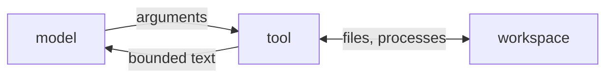

# 04 Tools that touch disk

**Part II · Act** · Difficulty: medium · 60 to 90 minutes · 8 graded cases

## What you are building

A program that can create files and run commands.

```sh
$ ./agent -p "write notes.md with three bullet points about Go, then show it to me"
Wrote notes.md and read it back: ...
```

You already have `read` from the previous chapter. This one adds `write` and `bash`.
Both are short. The work is in the three limits every tool needs.

## The three limits

| Limit | Question | What happens without it |
|---|---|---|
| who wrote the arguments | the model, so they cannot be trusted | a path escapes your project |
| how much comes back | unbounded | a command fills the context window |
| how long it may run | unbounded | a hung command wedges the program |



## Paths

Every path resolves against a workspace root and is refused if it leaves. Two rules:

**Resolve, then check.** A string search for `..` rejects the harmless `notes..txt`
and accepts a symlink that leaves the tree. Build the real path first, then ask
whether it is still inside.

**Refuse absolute paths.** A model has no reason to name `/etc/passwd`, and allowing
it makes the rules depend on which machine the program runs on.

```
  requested:  ../../etc/passwd
  joined:     /workspace/../../etc/passwd
  resolved:   /etc/passwd
  relative:   ../../etc/passwd        starts with .., refused
```

`read` and `write` share this check. A write that escapes is worse than a read,
because it creates files.

## Exit codes

A command that exits 3 has done something ordinary. The model asked for an operation,
the operation reported failure, and the model can decide what to do about it.

So `bash` returns text:

```
exit code: 3
before
```

and the program continues. Only two outcomes are errors: the process could not start,
and the user cancelled.

| Outcome | Result | Go error |
|---|---|---|
| exit 0 | `exit code: 0` plus output | none |
| exit 3 | `exit code: 3` plus output | none |
| output too long | capped, with a marker | none |
| tool timeout | `command timed out after 10s` | none |
| the user pressed Ctrl-C | none | `context.Canceled` |
| `sh` not found | none | start error |

## Two timeouts

```
  -timeout        bounds one provider request
  -tool-timeout   bounds one tool execution
```

They are separate because they fail differently. A slow model should not consume the
budget for running a test suite, and a long test suite should not look like a slow
model. Both are cancellable, because both arrive through a context.

## What you need to build

```go
type WriteTool struct{ Root string }

type BashTool struct {
    Root     string
    Timeout  time.Duration   // 0 means 10s
    MaxBytes int             // 0 means 20000
}
```

Arguments:

| Tool | Arguments |
|---|---|
| `write` | `{"path": string, "content": string}`, both required |
| `bash` | `{"command": string}`, run with `sh -c` in the workspace |

The program gains one flag:

```sh
agent -p "run the tests" -tool-timeout 300ms
```

## How you are checked

The verifier builds your program, creates a temporary workspace, scripts a tool call,
runs the binary with that directory as its working directory, and then reads the
requests, the files on disk, and stdout.

- `advertises-three-tools`: the request advertises `read`, `write` and `bash`.
- `writes-a-file`: the file exists afterwards with exactly the requested contents.
- `write-creates-parents`: `a/b/c/deep.txt` is created with none of those directories
  present.
- `write-refuses-escape`: `../escaped.txt` is not created, and the result names the
  escape.
- `bash-runs-a-command`: `ls && cat here.txt` returns the contents, which proves the
  working directory is the workspace.
- `bash-reports-exit-code`: `echo before; exit 3` returns both the output and the code,
  and the program exits 0.
- `bash-truncates-output`: 5000 lines yields at most 25 KB and a marker containing
  `truncated`.
- `bash-timeout-is-a-result`: with `-tool-timeout 300ms`, `sleep 5` returns a result
  containing `timed out`, exits 0, and finishes in under three seconds.

The disk is checked directly. A result that says a write happened is not evidence.

## Notes

`write` resolves the path before creating anything. Create the parents first and an
escaped path leaves a directory tree behind.

Capture stdout and stderr together. A failing command usually explains itself on
stderr.

A timeout is a result and a cancellation is an error. Distinguish `runCtx.Err()` from
`ctx.Err()`.

`exec.CommandContext` kills the process it started. It does not kill that process's
children, so `sh -c "sleep 100 &"` can leave a process behind. Fixing that needs
process groups, which are platform-specific.

## If you get stuck

<details><summary>First hint: the shape of the problem</summary>

Each tool has three decisions: whose argument, how much output, how long. Work out
which decision you got wrong from the failing case.
</details>

<details><summary>Second hint: what you will need</summary>

`os.MkdirAll`, `os.WriteFile`, `exec.CommandContext`, `cmd.CombinedOutput`,
`errors.As` for `*exec.ExitError`, `context.WithTimeout`.
</details>

<details><summary>Third hint: the finished tools</summary>

Share `resolveInside` with `read`. `write` calls `MkdirAll` on the parent, then
`WriteFile`, and returns the byte count. `bash` wraps the caller's context with the tool
timeout, runs `sh -c` with `cmd.Dir` set to the workspace, caps the combined output, and
maps the outcome: deadline to a timeout result, `*exec.ExitError` to an exit-code
result, anything else to a Go error.

`miyagi hint 04 <case-id>` prints the same three hints.
</details>

## Done when

`miyagi submit 04` reports 8/8, and asking the agent to create a file produces one.

[example.md](example.md) has the finished code, after you pass.

---

Next: **05 The agent loop**.
