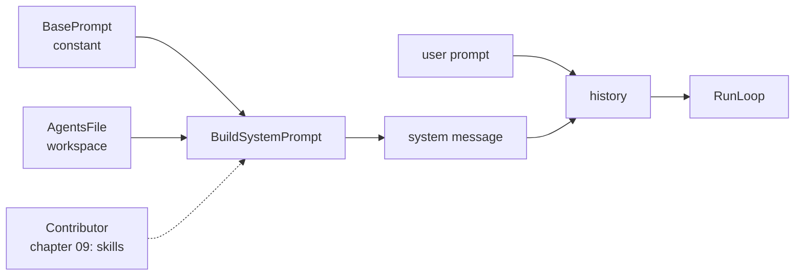

# 05 — Overview

*How prompt assembly works, and why it is a builder rather than a string. Read
this before you write code.*

---

## The request has a shape

Every request is a list of messages, and the first one is special:

```
[
  { "role": "system",  "content": "<who you are, what the rules are>" },
  { "role": "user",    "content": "<what the person asked>" },
  { "role": "assistant", ... },
  { "role": "tool", ... }
]
```

The system message is the only part of the conversation the user never wrote. It
is your agent's identity plus whatever the project says about itself. Everything
after it is the conversation.



## Why a builder and not a format string

A single `fmt.Sprintf` works until the second thing wants to contribute. Then it
becomes a format string with six placeholders and a `strings.Join` in the middle,
and every new section edits the same function.

The interface is small:

```go
type Contributor interface {
    Contribute(ctx context.Context) (string, error)
}
```

and the builder is a fold over the contributors. Chapter 09 adds skills by
implementing this interface. It does not edit the loop, the provider, or the
builder.

That is the point of the seam: **later chapters add files, not edits.**

## The prefix must be stable

Providers cache the beginning of a request. If the prefix matches the previous
request byte for byte, the computation is reused, and the response is cheaper and
faster. If one character changes, the cache misses.

So the system message must contain nothing that varies between runs:

| Allowed | Not allowed |
|---|---|
| a constant base instruction | a timestamp |
| file contents | a random session id |
| absolute file paths | map iteration order |
| a fixed section order | the current working directory as a sentence |

Absolute paths are allowed because they are stable for a given workspace. Map
iteration is not, which is the bug this chapter's stability case catches: two runs
over the same files must produce the same bytes.

```
  run 1:  base + "## /w/AGENTS.md" + rules      ─┐
  run 2:  base + "## /w/AGENTS.md" + rules      ─┴─ cache hit
  run 3:  base + timestamp + rules              ─── cache miss
```

## Discovery walks up, rendering runs down

A monorepo keeps rules at the root. A package adds its own. The agent should see
both, and when they disagree, the closer file should win.

Order is how you express that without a merge algorithm:

```
  /repo/AGENTS.md          outer rules          rendered first
  /repo/pkg/AGENTS.md      package rules        rendered last
```

A model reading top to bottom reaches the most specific rule at the end, which is
where a final instruction carries the most weight. Discovery therefore walks
upward, then reverses before rendering.

```
  cwd = /repo/pkg
  walk up:  /repo/pkg/AGENTS.md   ✓
            /repo/AGENTS.md       ✓
            /AGENTS.md            (missing)
  reverse:  [/repo/AGENTS.md, /repo/pkg/AGENTS.md]
```

The walk is bounded, because a file at `/` is not project instructions.

## Empty means absent

A file that exists and contains only whitespace is not an instruction. Rendering
its heading produces this:

```
# Project instructions

## /repo/AGENTS.md
                              ← nothing
```

The model reads a heading with no content and concludes that instructions existed
and were withheld. Dropping the section is more honest and keeps the prefix
shorter.

The same rule applies to the whole section: if no file contributed anything, do
not emit `# Project instructions` at all.

## What assembly must not do

It must not touch the user's text. The prompt the person typed arrives at the
model unchanged, as the second message. A wrapper added during assembly is a
wrapper the user cannot see and cannot debug.

| Layer | May change | Must not change |
|---|---|---|
| system message | assembled from contributors | nothing varies between runs |
| user message | nothing | the exact text the person typed |

## Where the real implementations go further

| Concern | pi | crush |
|---|---|---|
| Context file discovery | `docs/configuration.md`, project trust first | `internal/discover/` |
| Skill advertising | description-only until invoked | `internal/skills/` |
| Prompt cache control | provider-specific cache markers | provider adapters |

Two things they add that this chapter does not: a trust decision before loading
project files, and per-contributor sizes. Both are policy; the seam is the same.

## Self-check

1. Why is the system message a fold over contributors rather than one format
   string? *(Why a builder and not a format string)*
2. Name three things that must never appear in it. *(The prefix must be stable)*
3. Discovery goes up and rendering goes down. Why? *(Discovery walks up, rendering
   runs down)*
4. What does an empty AGENTS.md render as if you do not special-case it, and why is
   that bad? *(Empty means absent)*
5. Which message is allowed to be rewritten, and which is not? *(What assembly must
   not do)*
