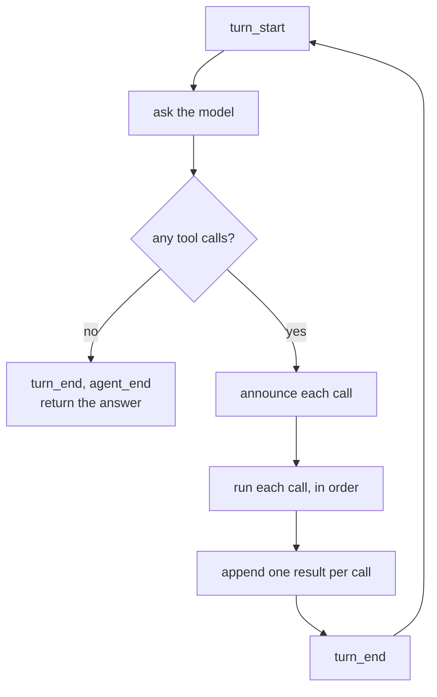
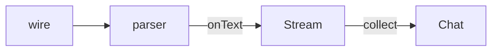

# 05 The agent loop

**Part II · Act** · Difficulty: medium · 60 to 90 minutes · 8 graded cases

## What you are building

A program that finishes a task it cannot do in one step.

```sh
$ ./agent -p "find every TODO in this directory and summarise them"
Three TODOs: two in agent/loop.go, one in README.md.
```

That takes several turns. List the files, read one, read another, then answer. The
number of turns is not known in advance, so the straight line you have becomes a loop.

You edit `agent/provider_openai.go` and `agent/cmd/agent/main.go`. You also create two new files, `agent/loop.go` and `agent/events.go`, holding the `RunLoop` and the event type this page describes.
## The loop

One exit condition, and one ceiling.



**The reply decides when to stop.** The program continues while the model asks for
tools, and stops when it does not. It does not run a fixed number of turns.

**The ceiling is separate.** A model that keeps asking for a tool happens when the
tool keeps failing, when the instruction is ambiguous, and when the model is small.
Without a limit the program runs until the account is empty.

```
  while the model asks for tools: do a turn      the exit condition
  ...and never more than N turns                 the ceiling
```

When the ceiling is reached the run has not finished, so it exits 1 and says why:

```
$ ./agent -p "loop forever" -max-steps 3
agent: step limit reached after 3 turns; the model kept asking for tools
$ echo $?
1
```

## Order

One assistant message can ask for several tools at once. They form one batch, and the
results go back in the order they were asked for, each with its own id.

```
  assistant:  call_a(read a.txt)   call_b(read b.txt)
  results:    call_a → "alpha"     call_b → "beta"      same order
```

The model reads the answers in the order it asked. Providers also reject a
conversation where a call has no result, or a result matches no call. Execution order
is yours; append order is not.

## Events

A conversation records what was said. It does not record what the program did, or
when. Without that, a slow run is indistinguishable from a stuck one, and a run that
finished looks like a run that hit the ceiling.

One line per thing that happened:

```json
{"type":"turn_start","turn":1}
{"type":"text","turn":1,"text":"I will read the file."}
{"type":"tool_call","turn":1,"id":"call_1","name":"read"}
{"type":"tool_result","turn":1,"id":"call_1","name":"read","bytes":5}
{"type":"turn_end","turn":1}
{"type":"turn_start","turn":2}
{"type":"text","turn":2,"text":"The file says alpha."}
{"type":"turn_end","turn":2}
{"type":"agent_end","turns":2,"reason":"done"}
```

Three rules the stream must satisfy:

1. Every `tool_call` id appears exactly once among the `tool_result` ids of that turn.
2. `agent_end` appears once, last.
3. `turns` equals the number of requests the server received.

## Two ways into the provider

`Chat` returns one finished message, which hides the part a terminal needs: text
arriving. The provider gains a second method:

```go
func (p *OpenAICompat) Stream(ctx context.Context, req Request, onText func(string)) (Message, Usage, error)
```

`Chat` becomes `Stream(ctx, req, nil)`. The wire does not change. The difference is
whether the caller can see each piece as it arrives, which the next chapters need.



## What you need to build

```go
type StreamingProvider interface {
    Provider
    Stream(ctx context.Context, req Request, onText func(string)) (Message, Usage, error)
}

type LoopOptions struct {
    MaxSteps int       // 0 means 20
    Emit     Emitter   // nil discards
}

type Result struct {
    Message Message   // the final assistant message
    History []Message // including every call and result
    Usage   Usage     // summed across requests
    Turns   int
}

func RunLoop(ctx context.Context, p StreamingProvider, tools *Registry,
    history []Message, opts LoopOptions) (Result, error)
```

```go
type Event struct {
    Type string; Turn int
    ID, Name, Text string
    IsError bool; Bytes, Turns int; Reason string
}
type Emitter func(Event)
func JSONEmitter(w io.Writer) Emitter
```

Two flags:

```sh
agent -p "..." -max-steps 3      stop after three requests
agent -p "..." -events           JSON events on stderr
```

## How you are checked

The verifier builds your program, scripts a conversation, and reads the request trace,
the events on stderr, stdout and the exit code.

- `loops-until-done`: a task needing two tools makes three requests and prints the
  answer.
- `preserves-result-order`: two calls in one message return two results in the same
  order with matching ids.
- `step-cap-stops`: with `-max-steps 3` and a model that always asks for a tool, exactly
  three requests, exit 1, and a message naming the limit.
- `events-sequence`: every `tool_call` id has exactly one `tool_result`, and `agent_end`
  appears once, last.
- `events-text-deltas`: the `text` events concatenate to the final answer, in at least
  two pieces.
- `single-turn-no-tools`: a plain reply produces one `turn_start`, one `turn_end`, one
  request.
- `continues-after-tool-error`: a failed tool does not end the run; a later turn
  succeeds, and the events mark the failure.
- `turn-count-matches-requests`: `agent_end.turns` equals the number of requests the
  server recorded.

## If you get stuck

<details><summary>First hint: the shape of the problem</summary>

Either the loop stops too early, stops too late, or reports something that did not
happen. The failing case id names which.
</details>

<details><summary>Second hint: what you will need</summary>

`json.NewEncoder(w).Encode` per event. `errors.Join` or a sentinel for the step limit.
A callback parameter for the streamed text. `sort.Ints` is not needed here, because
calls already arrive in index order.
</details>

<details><summary>Third hint: the finished loop</summary>

For each turn from 1 to the cap: emit `turn_start`, call `Stream` with a callback that
emits `text`, append the message. If it has no tool calls, emit `turn_end` and
`agent_end` with reason `done`, and return. Otherwise emit every `tool_call`, run each
call, emit `tool_result` with the same id, append the result messages in order, emit
`turn_end`. After the cap, emit `agent_end` with reason `step_limit` and return an
error.

`kata hint 05 <case-id>` prints the same three hints.
</details>

## Done when

`kata submit 05` reports 8/8, and the agent completes a task that needs three tool
calls.

[example.md](example.md) has the finished code, after you pass.

---

Next: **06 Prompt assembly**.
