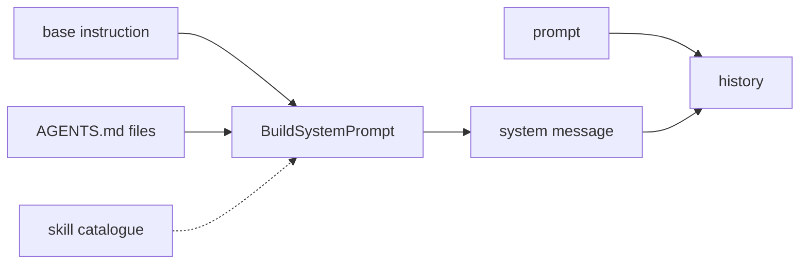

# 06 Prompt assembly

**Part III · Remember** · Difficulty: easy-medium · 45 to 60 minutes · 8 graded cases

## What you are building

An agent that follows the instructions in your repository.

```sh
$ printf '# Rules\n\nUse tabs, not spaces.\n' > AGENTS.md
$ ./agent -p "what rules apply here?"
Your AGENTS.md says to use tabs, not spaces.
```

Nothing in your code knew about that file. The program reads it before the first
request and puts it in front of the model.

You edit `agent/cmd/agent/main.go`. You also create one new file, `agent/prompt.go`, holding `BasePrompt`, the `Contributor` interface, `BuildSystemPrompt` and `AgentsFile`.
## The shape of a request

Every request is a list of messages, and the first one is special:

```json
[
  { "role": "system",    "content": "You are a coding agent..." },
  { "role": "user",      "content": "what rules apply here?" },
  { "role": "assistant", "content": "..." }
]
```

The system message is the only part of the conversation the person did not write. It
holds the agent's instructions plus whatever the project says about itself.

## Building it from parts

One `fmt.Sprintf` works until a second thing wants to contribute. Then it becomes six
placeholders and a `strings.Join`, and every new section edits the same function.

A small interface avoids that:

```go
type Contributor interface {
    Contribute(ctx context.Context) (string, error)
}
```

The builder walks the contributors in order and joins the non-empty sections. The
skills chapters add a contributor without touching the builder, the loop or the
provider.



## The prefix has to be stable

Providers cache the start of a request. If it matches the previous request byte for
byte, the work is reused and the answer is cheaper and faster. One changed character
and the cache misses.

So nothing that varies between runs may go in:

| Allowed | Not allowed |
|---|---|
| a constant instruction | a timestamp |
| file contents | a random id |
| absolute file paths | map iteration order |

Absolute paths are fine, because they are stable for a given workspace. Map iteration
is not, and that is what the stability case catches: two runs over the same files
produce the same bytes.

```
  run 1:  base + "## /w/AGENTS.md" + rules     ┐
  run 2:  base + "## /w/AGENTS.md" + rules     ┴  same prefix
  run 3:  base + timestamp + rules                changed
```

## Which file wins

A monorepo keeps rules at the root; a package adds its own. The agent should see both,
and when they disagree, the closer file should be the last word.

Order expresses that without a merge algorithm:

```
  /repo/AGENTS.md          outer rules           rendered first
  /repo/pkg/AGENTS.md      package rules         rendered last
```

A model reading top to bottom reaches the specific rule at the end. So discovery walks
upward, collecting files, then reverses before rendering.

```
  cwd = /repo/pkg
  walk up:  /repo/pkg/AGENTS.md   found
            /repo/AGENTS.md       found
            /AGENTS.md            missing
  reverse:  [/repo/AGENTS.md, /repo/pkg/AGENTS.md]
```

The walk is bounded. A file at `/` is not project instructions.

## Empty is absent

A file of whitespace is not an instruction. Rendering it produces a heading with
nothing under it, and the model reads that as instructions that were withheld.

```
# Project instructions

## /repo/AGENTS.md
                          nothing here
```

Drop the section. If no file contributed anything, do not emit `# Project
instructions` at all.

## What must not change

The person's prompt. It arrives at the model exactly as typed, as the second message.

| Layer | May change | Must not change |
|---|---|---|
| system message | assembled from contributors | nothing varies between runs |
| user message | nothing | the exact text typed |

## What you need to build

```go
const BasePrompt = `...`   // a constant, containing "coding agent"

type Contributor interface {
    Contribute(ctx context.Context) (string, error)
}

func BuildSystemPrompt(ctx context.Context, base string, contributors ...Contributor) (string, error)

type AgentsFile struct {
    Root     string   // discovery starts here
    MaxDepth int      // 0 means 8
}
```

Rendering:

```
You are a coding agent working in a terminal.
...

# Project instructions

## /abs/path/AGENTS.md
<file body>

## /abs/path/pkg/AGENTS.md
<file body>
```

Outermost first, nearest last, and no section at all when nothing contributed.

## How you are checked

The verifier builds your program, creates a temporary workspace (sometimes with
nested `AGENTS.md` files), runs the binary there, and reads the first message of the
request. Two runs are compared byte for byte.

- `system-message-first`: `messages[0]` is a system message containing the base
  instruction, and `messages[1]` is the prompt.
- `agents-md-included`: the workspace file's body appears, and the message names its
  path.
- `agents-md-from-parent`: running in `pkg/`, a file one directory up is included.
- `agents-md-order`: with both files, the outer body comes before the inner one.
- `no-agents-md`: with no such file, the base instruction is sent and no project
  section appears.
- `empty-agents-md`: a whitespace-only file produces no project section, and the base
  instruction is still there.
- `system-prompt-stable`: two runs in the same workspace produce identical content.
- `user-message-preserved`: the prompt arrives unchanged as `messages[1]`.

## Notes

The base prompt is a constant. No clock, no sentence about the working directory, no
random id.

Discovery walks up and is bounded to eight levels, which is enough for a monorepo and
stops the walk at `/`.

Emit the heading once, before the first file, and only if a file was included.

## If you get stuck

<details><summary>First hint: the shape of the problem</summary>

Either the system message is missing, the file was not found, the order is wrong, or
the bytes vary between runs.
</details>

<details><summary>Second hint: what you will need</summary>

`os.Getwd`, `filepath.Dir` until it stops changing, `os.Stat`, `os.ReadFile`,
`strings.TrimSpace`, `strings.Builder`.
</details>

<details><summary>Third hint: the finished builder</summary>

`BuildSystemPrompt` writes the trimmed base, then each non-empty section separated by
a blank line. `AgentsFile.discover` collects `AGENTS.md` from the working directory
upward within the depth limit, then reverses the slice. `Contribute` reads each file,
skips empty bodies, writes the heading once, and renders `## <path>` followed by the
body. In `main`, prepend `{Role: RoleSystem, Content: system}` to the history.

`miyagi hint 06 <case-id>` prints the same three hints.
</details>

## Done when

`miyagi submit 06` reports 8/8, and an `AGENTS.md` at the repo root applies when you run
the agent in a subdirectory.

[example.md](example.md) has the finished code, after you pass.

---

Next: **07 Sessions**.
