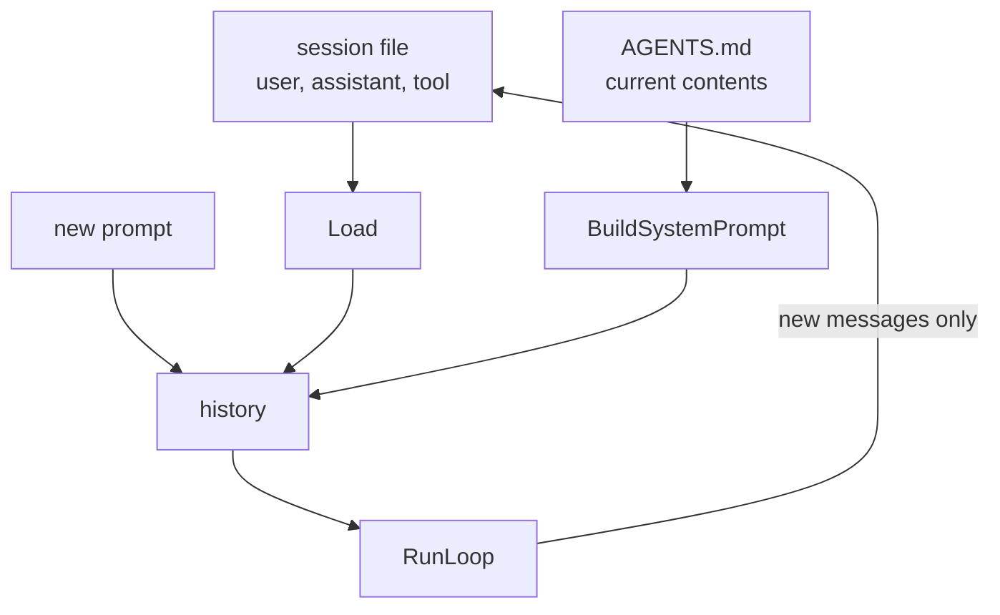

# 06 — Overview

*How sessions work, and what belongs in one. Read this before you write code.*

---

## A session is a log, not a snapshot

There are two ways to persist a conversation. You can save the current state, or
you can save every change that produced it.

Snapshots are smaller and easier to read. Logs win on two properties that matter
here:

| Property | Snapshot | Append-only log |
|---|---|---|
| A crash mid-write | the file is half-written and useless | the last line is lost, the rest is fine |
| Two readers | must agree on a lock | both read the same prefix |
| History of how you got here | lost | kept |

So the format is one JSON object per line:

```
{"type":"header","version":1,"created":"2026-10-27T10:00:00Z"}
{"type":"message","message":{"role":"user","content":"which branch?"}}
{"type":"message","message":{"role":"assistant","content":"release"}}
```

JSONL also means `tail -f work.jsonl` is a debugging tool, and `jq` is the query
language. Neither needs your program.

## Store the conversation. Rebuild the policy.

The session holds user, assistant and tool messages. It does **not** hold the
system message.



Two reasons the system message stays out:

1. **It is policy for this run.** If `AGENTS.md` changed since yesterday, the agent
   should follow the new rules, not replay the old ones.
2. **It must appear once.** A program that both stores it and rebuilds it sends
   two on resume, and the second contradicts the first.

The rule generalises: **store facts, rebuild decisions.**

## Resume is a slice, and the slice is where the bug is

The obvious implementation loads the history, appends it to the new request, and
then records "everything" afterwards. That records the loaded history a second
time:

```
  turn 1:  file = [u1, a1]
  resume:  history = [system, u1, a1, u2]
  save:    history[1:] = [u1, a1, u2]      ← u1 and a1 written again
  file =   [u1, a1, u1, a1, u2]
```

The next run sends `u1, a1, u1, a1, u2`, so the model sees the conversation
twice, the context fills twice as fast, and nothing looks obviously wrong.

The fix is one number. Remember how many messages were loaded, and save only what
comes after them:

```go
prior := rec.Load()
history := append([]Message{{Role: RoleSystem, Content: system}}, prior...)
history = append(history, userMessage)
// ...
for _, m := range res.History[len(prior)+1:] {
	rec.Append(m)
}
```

`len(prior)+1` skips the system message and the loaded history in one expression.
That `+1` is the chapter.

## Tool pairs cross run boundaries too

A conversation with a tool call and no result is invalid: providers reject it. A
resumed conversation is no different, which means the session must record
**assistant messages with their tool calls**, not only the results.

```
{"role":"assistant","toolCalls":[{"id":"call_1","name":"read","arguments":"..."}]}
{"role":"tool","toolCallId":"call_1","content":"alpha"}
```

Record one and not the other, and the next run fails with a message about orphaned
tool calls, three chapters after the bug was introduced.

## Why a Recorder interface

The loop does not know where history lives. It is handed a history and returns a
longer one. Sessions are a layer around the loop, which is why this chapter adds
one file and edits `main`, and touches neither the loop nor the provider.

| Layer | Knows about | Does not know about |
|---|---|---|
| loop | messages, tools, providers | files, paths, formats |
| session | a file, append, load | the loop, the model, tools |
| main | flags, wiring | neither implementation detail |

## What this chapter does not do

- No branching. One file is one linear conversation.
- No compaction. The file grows forever; chapter 07 starts deleting from the
  *request* while keeping the file intact.
- No concurrency. Two processes appending to one session interleave, and nothing
  here prevents it.

That last gap is worth naming rather than hiding. It is why pi locks its session
files (`proper-lockfile` in its dependency list) and why this course defers it.

## Where the real implementations go further

| Concern | pi | PiG |
|---|---|---|
| Session shape | tree, every entry has a parent | ported tree |
| Branching and forking | copy a subtree into a new file | ported |
| Compaction | a summary entry replaces older messages *in the request* | ported |
| Locking | `proper-lockfile` | ported |

The tree is what makes branching and compaction cheap. This chapter uses a line,
which is the honest minimum and enough for eleven chapters.

## Self-check

1. Why does an append-only log beat a snapshot after a crash? *(A session is a log,
   not a snapshot)*
2. Name the two reasons the system message is not stored. *(Store the
   conversation. Rebuild the policy.)*
3. What exactly does `len(prior)+1` skip? *(Resume is a slice, and the slice is
   where the bug is)*
4. Which two records must both be written for a tool call, and what happens if one
   is missing? *(Tool pairs cross run boundaries too)*
5. What does this chapter deliberately not handle? *(What this chapter does not
   do)*
