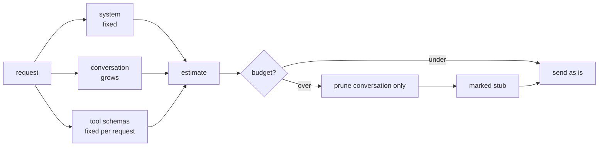
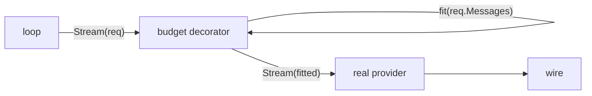

# 07 — Overview

*How a context budget works, and what pruning must not break. Read this before
you write code.*

---

## Two budgets, and the bigger one is invisible

A request costs tokens in two places:

```
  system message     ~50 tokens
  conversation       grows every turn
  tool schemas       ~200 tokens per request, forever
```

The third line surprises people. Tool schemas are sent with **every** request,
whether or not the model calls a tool. They are a fixed tax on every turn.

Measured on a real harness (fx, 13 tools): a cold request was 23,884 bytes, of
which 15,560 were tool schemas. Sixty-five percent of the request was definitions.
The conversation had not started yet.



Consequences:

- pruning the conversation cannot rescue a request whose schemas alone exceed the
  budget;
- shrinking schemas (fewer tools, shorter descriptions) is a real lever, and it is
  why harnesses advertise tools lazily;
- the estimate must count both, or the accounting lies.

## Ceiling versus threshold

A **threshold** triggers work when a number is crossed. A **ceiling** is a
constraint every request must satisfy.

```
  threshold:  if tokens > 8000 then prune      ← may fire a turn too late
  ceiling:    fit(messages, 8000) on every request
```

Thresholds are easier and they overshoot. A single large tool result can push a
request past the window before any threshold notices, and the request fails with a
provider error rather than being adjusted.

So the rule here is the stricter one: every outgoing request is fitted. The cost
is fitting on every turn, which is a few hundred microseconds of arithmetic.

## Pruning is a decorator

The budget has to apply to every request the loop makes, including the ones in
later turns. There are two ways to get that:

1. put a `Trim` call inside the loop;
2. wrap the provider.

This chapter wraps:

```go
provider = agent.WithBudget(provider, tools, maxContext, emit)
```



The loop still sends a conversation and still knows nothing about tokens. The
decorator is where policy lives, which is exactly what the seam from chapter 01
was for. Chapter 08 uses the same trick for cancellation.

## What survives a cut

Four rules, in priority order:

| Priority | Rule | Why |
|---|---|---|
| 1 | keep the system message | instructions are not negotiable |
| 2 | keep the newest messages | the current task is what the model needs |
| 3 | never keep a tool result without its call | the conversation becomes invalid |
| 4 | leave a marker where history was removed | the model must know it is blind there |

Rule 3 is the one that is easy to miss and expensive to debug. Walking backwards
means the cut lands wherever the budget runs out, which can be between an
assistant message and its tool results:

```
  ... assistant: call_1   ← dropped
      tool: call_1 result ← kept          invalid
```

Dropping the orphaned result is the cheapest fix and it is what this chapter
grades.

## The marker matters more than it looks

Without it, the model sees a conversation that begins mid-sentence and concludes
that this is the whole history. It will answer confidently about work it cannot
see.

```
[context pruned: 31 earlier messages omitted to fit 2000 tokens]
```

That line costs almost nothing and changes the answer from confident to cautious.

## Estimation is allowed to be crude

An exact tokenizer needs a vocabulary, a model-specific table, and a dependency.
The decision being made, "is this over budget", has a wide margin, so four bytes
per token is enough.

Two properties matter more than accuracy:

1. **monotonic.** Adding content never lowers the estimate. Otherwise pruning
   oscillates: drop, re-estimate lower, stop dropping, overflow.
2. **counts everything that is sent.** Messages, tool calls inside messages, and
   tool schemas.

Divide by four **once at the end**. Dividing per message rounds every small cost
to zero and under-counts long conversations by a lot.

## What this chapter deliberately does not do

- **No summarisation.** Dropped messages are gone from the request, not replaced by
  a summary. The session file keeps them, which is what makes a later chapter able
  to add summarisation without losing data.
- **No recall tool.** A model cannot ask for a pruned message back. pi-condense
  does exactly that with a `context_tree_query` tool, and it is the natural next
  step after this chapter.
- **No schema pruning.** The tool definitions are counted but never reduced. Fewer
  tools, lazy schemas, and description caps are a separate mechanism.

## Where the real implementations go further

| Concern | Implementation |
|---|---|
| Recovery of pruned content | pi-condense, `context_tree_query` |
| Tool-schema gating | toolflow, stage-gated mounting |
| Compaction as a session entry | pi, `compaction` record type |
| The bug this chapter prevents | pi-context-prune, which deletes results and orphans calls |

The last row is worth reading. A published, widely used pruning extension shipped
the exact failure that rule 3 describes: it removed tool results, kept the calls,
and let the provider synthesise an error result in their place.

## Self-check

1. Which part of a request is a fixed cost per turn, and roughly how large is it?
   *(Two budgets, and the bigger one is invisible)*
2. Why is a ceiling stricter than a threshold, and what does the extra strictness
   cost? *(Ceiling versus threshold)*
3. Why is the budget a decorator rather than a line in the loop?
   *(Pruning is a decorator)*
4. Which rule prevents an invalid conversation, and what does the cut look like
   when it is violated? *(What survives a cut)*
5. Name the two properties an estimate needs more than accuracy.
   *(Estimation is allowed to be crude)*
