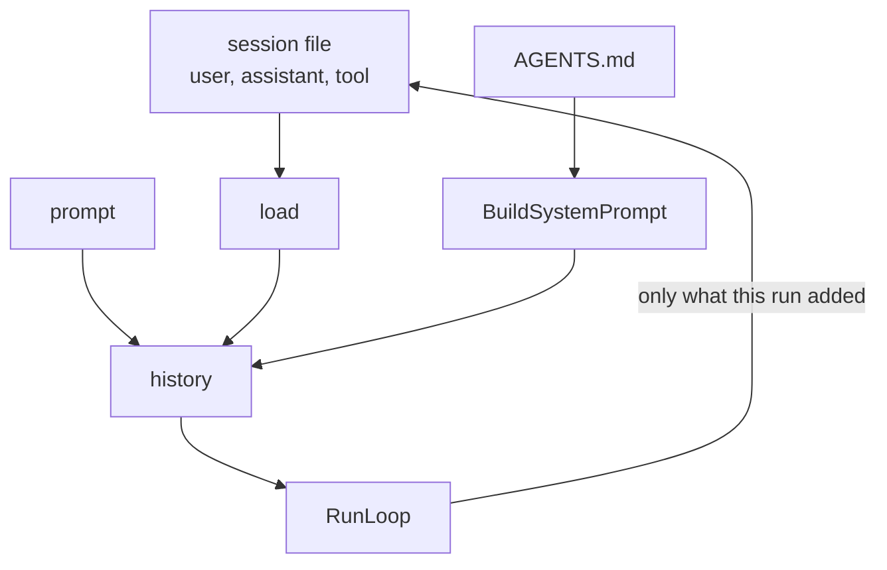

# 07 Sessions

**Part III · Remember** · Difficulty: medium · 60 to 90 minutes · 8 graded cases

## What you are building

An agent that remembers yesterday.

```sh
$ ./agent -p "remember: we deploy from the release branch" -session work.jsonl
$ ./agent -p "which branch do we deploy from?" -session work.jsonl
release
```

The second run is a new process. Everything it knows about the first run comes from a
file.

You edit `agent/cmd/agent/main.go`. You also create one new file, `agent/session.go`, holding the `Recorder` interface, the JSONL format and `OpenSession`.
## A log, not a snapshot

There are two ways to save a conversation. Write down the current state, or write
down every change that produced it.

| | Snapshot | Append-only log |
|---|---|---|
| crash mid-write | half a file, useless | last line lost, the rest is fine |
| reading it | needs a lock | reads a prefix |
| how you got here | lost | kept |

So the file is one JSON object per line:

```
{"type":"header","version":1,"created":"2026-10-27T10:00:00Z"}
{"type":"message","message":{"role":"user","content":"which branch?"}}
{"type":"message","message":{"role":"assistant","content":"release"}}
```

`tail -f work.jsonl` follows a session as it happens. `jq` queries it. Neither needs
your program to be running.

## Store the conversation, rebuild the instructions

The session holds user, assistant and tool messages. It does not hold the system
message.



Two reasons. If `AGENTS.md` changed since yesterday, the agent should follow the new
rules rather than replay the old ones. And the system message must appear exactly
once; a program that stores it and rebuilds it sends two, and they disagree.

## The slice where the bug lives

The obvious version loads the history, appends the new request, and then records
everything afterwards. That records the loaded history a second time:

```
  file:    [u1, a1]
  resume:  history = [system, u1, a1, u2]
  save:    history[1:] = [u1, a1, u2]        u1 and a1 written again
  file:    [u1, a1, u1, a1, u2]
```

The next run sends the conversation twice, the context fills twice as fast, and
nothing looks wrong.

Remember how many messages you loaded, and save only what comes after them:

```go
prior := rec.Load()
history := append([]Message{{Role: RoleSystem, Content: system}}, prior...)
history = append(history, userMessage)
// ... run ...
for _, m := range res.History[len(prior)+1:] {
	rec.Append(m)
}
```

`len(prior)+1` skips the system message and the loaded messages together.

## Tool calls cross the boundary too

A conversation with a call and no result is invalid. A resumed conversation is no
different, so the file must record assistant messages with their tool calls, not only
the results.

```
{"role":"assistant","toolCalls":[{"id":"call_1","name":"read","arguments":"..."}]}
{"role":"tool","toolCallId":"call_1","content":"alpha"}
```

Write one and not the other and the next run fails with a message about orphaned
calls, several chapters after the mistake.

## What you need to build

```go
const SessionVersion = 1

type Recorder interface {
    Load() ([]Message, error)
    Append(Message) error
    Close() error
}

func OpenSession(path string) (*JSONLSession, error)
```

```
{"type":"header","version":1,"created":"..."}
{"type":"message","message":{"role":"user","content":"..."}}
```

One flag:

```sh
agent -p "..." -session work.jsonl
```

A missing file is a new session. Missing parent directories are created.

## How you are checked

The verifier runs the binary twice against the same session path with different
scripted replies, then reads the second request and the file itself. Some cases add a
tool call on the first run.

- `creates-session-file`: the file exists and is not empty after one run.
- `session-is-jsonl`: every line is JSON with a `type`, and line 1 is a header
  carrying a version.
- `resumes-history`: the second request is `system`, `user`, `assistant`, `user` in
  that order, with the first run's text intact.
- `appends-not-overwrites`: the file grew after the second run, and the first question
  appears exactly once.
- `no-duplicate-turns`: the first run's answer appears exactly once in the second
  request.
- `system-not-duplicated`: exactly one system message, at index 0, rebuilt from the
  current `AGENTS.md`.
- `tool-history-persisted`: the resumed request holds both the assistant's tool call
  and the matching result.
- `missing-session-is-created`: a path in a directory that does not exist yet works,
  and the next run resumes it.

## Notes

Save only what the run added: `res.History[len(prior)+1:]`.

Persist before returning an error. A run that hit the step limit still produced turns
worth keeping.

Write the header once, when the file did not exist.

A malformed line is an error. Skipping it silently turns a broken session into a
different conversation.

## If you get stuck

<details><summary>First hint: the shape of the problem</summary>

Either the file is wrong, the load is wrong, or the save writes too much.
</details>

<details><summary>Second hint: what you will need</summary>

`os.OpenFile` with `O_CREATE|O_WRONLY|O_APPEND`, `bufio.Scanner` over the file,
`encoding/json` per line, `errors.Is(err, os.ErrNotExist)` to detect a new file.
</details>

<details><summary>Third hint: the finished recorder</summary>

`OpenSession` creates parents, checks whether the file exists, opens for append, and
writes a header when new. `Load` scans lines, unmarshals a probe holding `type` and
`version`, skips the header, and collects `message` records. `Append` writes one record
plus a newline. In `main`, build `[system] + prior + [user]`, run the loop, then append
`res.History[len(prior)+1:]`.

`kata hint 07 <case-id>` prints the same three hints.
</details>

## Done when

`kata submit 07` reports 8/8, and a fact told in one run is recalled in the next.

[example.md](example.md) has the finished code, after you pass.

---

Next: **08 Context budget**.
