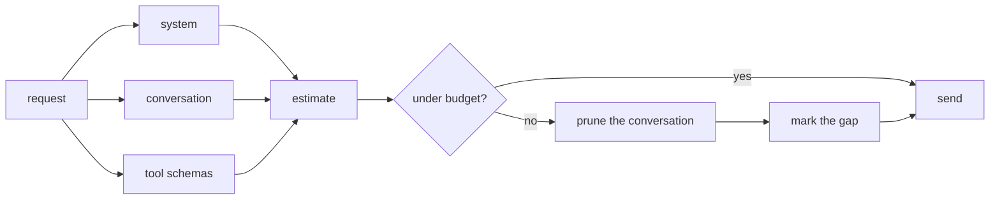

# 08 Context budget

**Part III · Remember** · Difficulty: hard · 90 to 120 minutes · 8 graded cases

## What you are building

An agent that keeps working when the conversation no longer fits.

```sh
$ ./agent -p "summarise where we are" -session long.jsonl -max-context 2000 -events
{"type":"budget","turn":1,"tokens":1840,"budget":2000,"pruned":31}
a long answer that still knows what you were doing
```

The session is longer than the window. The request is not.

You edit `agent/events.go` and `agent/cmd/agent/main.go`. You also create one new file, `agent/budget.go`, holding the estimate, the fit and the provider wrapper.
## Two budgets

A request costs tokens in three places:

```
  system message      about 50 tokens
  conversation        grows every turn
  tool schemas        about 200 tokens per request, every request
```

The third one is easy to miss. Tool schemas travel with every request whether or not
the model calls a tool, so they are a fixed cost per turn. In one measured harness
with thirteen tools, 15,560 of a 23,884 byte request were tool definitions, before the
conversation had started.

So the estimate has to count both, and pruning the conversation cannot rescue a
request whose schemas alone exceed the budget.



## A ceiling, not a threshold

A threshold prunes when a number is crossed, which means it overshoots: one large tool
result pushes the request past the window before anything notices, and the provider
rejects it.

A ceiling fits every request before it is sent. That costs a few hundred microseconds
of arithmetic per turn, and it cannot be surprised.

## Pruning is a wrapper

The rule has to apply to every request, including later turns. Two ways:

1. call a function inside the loop;
2. wrap the provider.

Wrap it:

```go
provider = agent.WithBudget(provider, maxContext, emit)
```

The loop still sends a conversation and still knows nothing about tokens. The wrapper
fits the messages and emits what it did.

## What survives

Four rules, in order:

| Priority | Rule | Why |
|---|---|---|
| 1 | keep the system message | instructions are not negotiable |
| 2 | keep the newest messages | the current task is what the model needs |
| 3 | never keep a tool result without its call | the conversation becomes invalid |
| 4 | leave a marker where history was removed | the model must know it is blind there |

Rule 3 is the one that bites. Walking backwards means the cut lands wherever the
budget runs out, which can be between an assistant message and the results answering
it:

```
  ... assistant: call_1        dropped
      tool: call_1 result      kept        invalid
```

Dropping the orphaned result is the cheap fix.

Rule 4 costs one line and changes the answer from confident to careful:

```
[context pruned: 31 earlier messages omitted to fit 2000 tokens]
```

## Estimation

An exact tokenizer needs a vocabulary, a model-specific table and a dependency. The
decision here is only "is this over budget", and the margin is wide, so four bytes per
token is enough.

Two properties matter more than accuracy. Adding content must never lower the
estimate, or pruning oscillates: drop, re-estimate lower, stop dropping, overflow. And
the estimate must count everything that is sent, including tool calls inside messages
and the schemas.

Divide by four once at the end. Dividing per message rounds every small cost to zero.

## What you need to build

```go
const DefaultMaxContext = 8000

func EstimateTokens(msgs []Message, tools []ToolDef) int
func Fit(msgs []Message, tools []ToolDef, budget int) ([]Message, int)
func WithBudget(p StreamingProvider, budget int, emit Emitter) StreamingProvider

const EventBudget = "budget"
// Event gains Tokens, Budget, Pruned int
```

One flag, one event, one marker:

```sh
agent -p "..." -max-context 2000 -events
```

```json
{"type":"budget","turn":1,"tokens":1840,"budget":2000,"pruned":31}
```

```
[context pruned: 31 earlier messages omitted to fit 2000 tokens]
```

## How you are checked

The verifier builds your program, writes a session file in the format from the previous
chapter, runs with a small ceiling, then reads the budget events on stderr and the
request messages the server recorded.

- `budget-event-reported`: at least one `budget` event, with a positive `tokens` and
  the configured ceiling.
- `estimate-counts-tools`: one short prompt estimates at 50 tokens or more, because
  three tool schemas are not free.
- `estimate-grows-with-history`: twelve prior messages estimate higher than two.
- `ceiling-respected`: with `-max-context 500`, every event reports at most 500.
- `prunes-when-over`: a 40-message session reports `pruned > 0` and sends far fewer
  messages than it loaded.
- `prune-marker-present`: the request carries the marker text.
- `no-orphaned-tool-pairs`: after a cut, no tool message appears whose call was not
  announced earlier.
- `keeps-system-and-newest`: the system message is first and still contains the
  `AGENTS.md` body, and the last message is the prompt just typed.

## Notes

Keep the system message out of the walk: fit the conversation after index 0, then
reassemble.

Walk backwards. Keeping the newest is the point, so the cut belongs at the old end.

Always keep one message. A single message larger than the budget is a fact, not
something pruning can fix.

Drop orphaned tool results after the cut and count them as pruned.

`-max-context 0` disables the wrapper rather than setting a ceiling of zero.

## If you get stuck

<details><summary>First hint: the shape of the problem</summary>

Either the estimate is wrong, the fit keeps the wrong end, or the request is still too
large when it goes out.
</details>

<details><summary>Second hint: what you will need</summary>

`json.Marshal` on a tool's `Parameters` for its size. A backwards loop over messages. A
struct that implements `StreamingProvider` and delegates.
</details>

<details><summary>Third hint: the finished code</summary>

`EstimateTokens` sums role, content, tool-call fields and a per-message overhead, adds
each tool's name, description and marshalled schema, and divides by four.
`Fit` keeps `msgs[0]` when it is a system message, walks the remainder backwards
accumulating until the estimate would exceed the budget, drops leading tool results,
and returns the system message, one marker when anything was dropped, and the kept
tail. `WithBudget` returns a decorator whose `Stream` fits, emits the event, and
delegates.

`kata hint 08 <case-id>` prints the same three hints.
</details>

## Done when

`kata submit 08` reports 8/8, and a long session still gets an answer under a small
ceiling.

[example.md](example.md) has the finished code, after you pass.

---

Next: **09 Steer and abort**.
