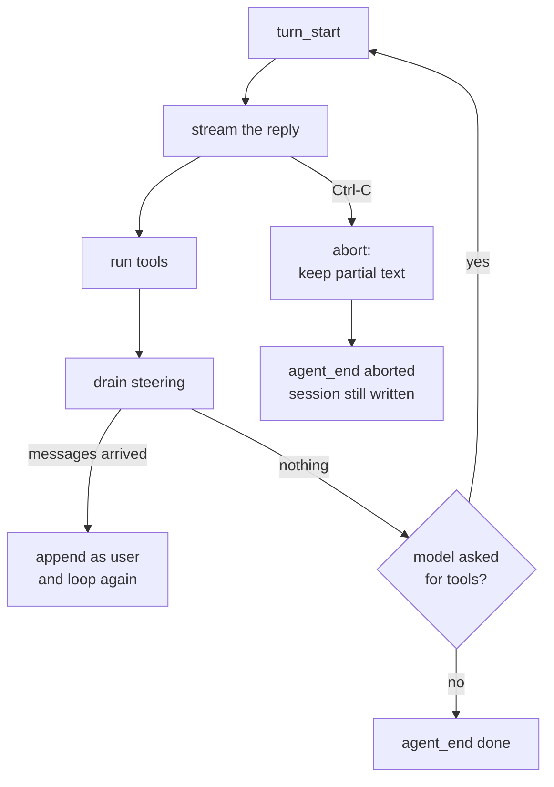

# 08 — Overview

*How interruption and steering work. Read this before you write code.*

---

## Two clocks, one conversation

A run is not a function call. It takes seconds, sometimes minutes, and a person is
sitting in front of it. Two things become possible:

- stop it;
- say something while it is going.

Both need the same thing: a boundary where a new event can enter without corrupting
the conversation. That boundary is the end of a turn.



## Abort: the text already arrived

The important property is not "the program stops". It is that **stopping does not
erase what the user already read**.

A streaming client accumulates text as it arrives. When the request is cancelled,
the read fails part-way. Most implementations return an empty message with an
error, and the caller prints the error. That loses the half-sentence the user was
looking at, and it makes "I interrupted it" indistinguishable from "it crashed".

So the parser returns both:

```go
return Message{Role: RoleAssistant, Content: content.String()}, usage,
	fmt.Errorf("read stream: %w", err)
```

and the loop keeps it:

```go
if err != nil {
	if msg.Content != "" {
		history = append(history, msg)
	}
	...
}
```

Three consequences, and all three are graded:

| Behaviour | Without it |
|---|---|
| partial text printed | the user sees an error and loses the answer |
| exit code 130 | a script cannot tell interrupted from failed |
| the turn persisted | the next run repeats work the user already saw |

Exit 130 is the shell convention for a process stopped by SIGINT (128 + 2). It is
not a detail: `if agent -p ...; then ...` should be able to reason about it.

## Steering: a boundary, not a merge

The tempting implementation is to append what the user typed to the prompt. That
is wrong in a way that looks fine on a short run: the model answers a prompt the
user did not type, and the reply addresses a question that was already being
answered.

The correct place is the end of the turn:

```
  request 1:  system, user("add a flag")
  reply 1:    "I added the flag."
  steer:      "also check the tests"        ← typed during reply 1
  request 2:  system, user, assistant, user("also check the tests")
```

Two properties follow, and both are graded:

1. **It is a new message, not an edit.** The first request must not contain the
   steering text at all.
2. **It keeps the run alive.** If the model said it was done and the user then says
   something, the run must continue. Stopping would ignore the person.

```
  done condition:  no tool calls  AND  nothing steered
```

That `and` is the whole design. Without it, a steered message after a finished
answer is accepted, recorded, and ignored.

## A queue needs a lock and a clear

Steering arrives on a goroutine reading stdin, and is consumed on the loop's
goroutine. Two rules make that safe:

- **Drain takes and clears under a lock.** A queue that is read but not cleared
  replays the same instruction every turn.
- **Drain never blocks.** A hook that waits for input turns the loop into a program
  that waits for a human, which is the opposite of the feature.

```go
func (s *StdinSteering) Drain() []Message {
	s.mu.Lock()
	defer s.mu.Unlock()
	if len(s.queue) == 0 {
		return nil
	}
	out := s.queue
	s.queue = nil
	return out
}
```

## Why this chapter edits the loop

Every previous chapter added files. This one changes `loop.go`, and that is
deliberate: steering is a state transition inside the loop, not a policy around
it. The budget could be a provider decorator because it only rewrites a request.
Steering changes the history the loop owns, so it belongs there.

The rule is not "never touch the loop". It is "touch the loop only for loop state".
This is loop state.

## What this chapter does not do

- **No interactive UI.** Steering comes from stdin as lines, which is enough to
  prove the mechanism without building a terminal application.
- **No queue persistence.** An undelivered steered message dies with the process.
- **No graceful process-group teardown.** A cancelled tool's grandchildren are
  still the known limitation from chapter 03.

## Where the real implementations go further

| Concern | pi | crush |
|---|---|---|
| Steering messages | `getSteeringMessages` in the loop | `internal/agent/coordinator.go` |
| Abort | `AbortSignal` through every layer | context plus a cancel channel |
| Queue drain points | after the assistant turn, one-at-a-time or all | queued run ids |

pi distinguishes steering from follow-up messages: steering enters during a run,
follow-ups only after it ends. This chapter has one queue, which is the honest
minimum for two graded claims.

## Self-check

1. What must survive an interrupt, and what does the exit code 130 tell a script?
   *(Abort: the text already arrived)*
2. Where does a steered message enter, and what is wrong with merging it into the
   prompt? *(Steering: a boundary, not a merge)*
3. State the done condition of the loop in one line. *(Steering: a boundary, not a
   merge)*
4. Why must Drain clear the queue, and why must it not block?
   *(A queue needs a lock and a clear)*
5. Why is editing the loop justified here when a decorator was right for the
   budget? *(Why this chapter edits the loop)*
