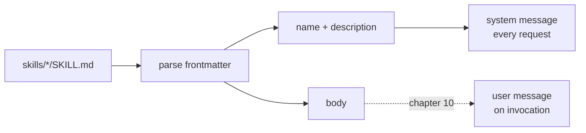

# 09 — Overview

*How a skill catalogue works. Read this before you write code.*

---

## One file, two audiences

A skill is a folder with a `SKILL.md`:

```
skills/deploy/SKILL.md
---
name: deploy
description: Deploy the app to a region.
---
Check the tests pass, then deploy to $0 in $1.
```

The file has two audiences and they read different parts:

| Part | Audience | When it is sent |
|---|---|---|
| `name`, `description` | the model, every request | always |
| body | the model, only when the skill is invoked | chapter 10 |
| the header | you, and the loader | never |

That split is the feature. A project with fifty skills pays fifty lines on every
request, not fifty documents.



## The catalogue is a Contributor

Chapter 05 built the seam for exactly this:

```go
system, err := agent.BuildSystemPrompt(ctx, agent.BasePrompt,
	&agent.AgentsFile{Root: root},
	catalog,                  // ← added in this chapter
)
```

`Catalog.Contribute` renders the list. The prompt builder does not change, and the
loop does not change. That is the fourth chapter in a row where a feature arrived
without touching either.

## Why the frontmatter is not YAML

`name:` and `description:` on their own lines between `---` fences is enough here,
and needs no dependency. A real format often uses YAML with lists and nesting; that
is a specification, and it is not the lesson.

Two rules matter more than the format:

1. **A file that cannot be parsed is skipped, not fatal.** One broken skill must not
   stop the agent from starting.
2. **A missing `skills/` directory is not an error.** Most projects have none.

## What this chapter does not do

- **No invocation.** Nothing runs `/deploy` yet; that is chapter 10.
- **No scripts.** A skill is instructions, not a bundled program.
- **No model-chosen skills.** The person types the command.

## Self-check

1. Which part of a skill is sent on every request, and which is not?
   *(One file, two audiences)*
2. What happens to a skill file with no frontmatter, and why is that the right
   choice? *(Why the frontmatter is not YAML)*
3. Why does a missing `skills/` directory have to succeed?
   *(Why the frontmatter is not YAML)*
4. What did the catalogue attach to, and what did not have to change?
   *(The catalogue is a Contributor)*
