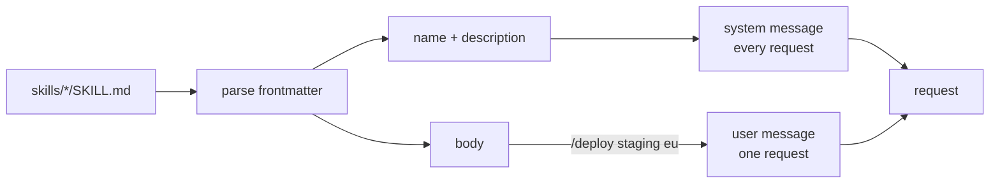

# 09 — Overview

*How skills work, and why the description is separate from the body. Read this
before you write code.*

---

## One file, two audiences

A skill is a folder with a `SKILL.md`:

```
skills/deploy/SKILL.md
---
name: deploy
description: Deploy the app to a region.
---
Check the tests pass, then deploy to $0 in $1.
Report the deployed version. Full request: $ARGUMENTS
```

The file has two audiences and they read different parts:

| Part | Audience | When it is sent |
|---|---|---|
| `name`, `description` | the model, every request | always |
| body | the model, only when invoked | on `/deploy` |
| the whole file | you, and the agent's loader | never verbatim |

That split is the feature. A project with fifty skills pays fifty lines on every
request, not fifty documents. The alternative, sending every body, is the tool
schema problem from chapter 07 with a different name.



## Invocation is text substitution, not a tool call

A tool call is the model's decision. A skill invocation is the person's: they type
`/deploy staging`, and the agent expands it before the model sees anything.

```
  typed:   /deploy staging eu-west
  sent:    Check the tests pass, then deploy to staging in eu-west.
           Report the deployed version. Full request: staging eu-west
```

Three consequences:

1. **The model never sees the shorthand.** It sees instructions, which is what it
   can act on.
2. **Expansion happens before the session records the turn.** A resumed run replays
   what was sent, not the shorthand.
3. **An unknown name is passed through.** Deleting the person's text because of a
   typo is worse than sending a slash command the model ignores.

## Placeholders

Two forms, often in one body:

| Placeholder | Replaced with |
|---|---|
| `$ARGUMENTS` | everything after the skill name, as one string |
| `$0`, `$1`, `$2` | one whitespace-separated word, by position |
| `$9` with no argument | the empty string |

Replace `$ARGUMENTS` **first**. Both forms start with `$`, and a positional pass
that runs first can corrupt the longer token.

```
  args:  staging eu-west
  "Deploy to $0 in $1. Full: $ARGUMENTS"
  → "Deploy to staging in eu-west. Full: staging eu-west"
```

Arguments are split on whitespace. Quoting inside an argument is not handled, and
the overview says so rather than implying otherwise.

## Stacking

One prompt can name several skills. Arguments run from the skill name to the next
slash command:

```
  "/review /deploy production eu-west"

  review  → arguments: ""                    (nothing before the next command)
  deploy  → arguments: "production eu-west"
```

Expansion walks left to right and preserves order, because the order is the
instruction. "Review, then deploy" and "deploy, then review" are different jobs.

## The catalogue is a Contributor

Chapter 05 built the seam for exactly this:

```go
system, err := agent.BuildSystemPrompt(ctx, agent.BasePrompt,
	&agent.AgentsFile{Root: root},
	catalog,                  // ← skills, added in this chapter
)
```

`Catalog.Contribute` renders the list. The prompt builder did not change. The loop
did not change. That is the third chapter in a row where a feature arrived without
touching either.

## Why the frontmatter is not YAML

`name:` and `description:` on their own lines between `---` fences is enough for
this feature and needs no dependency. A real `SKILL.md` format often uses YAML with
lists and nesting; that is a dependency and a specification, and neither is the
lesson here.

The rule this chapter does keep from real formats: **a file that cannot be parsed is
skipped, not fatal.** One malformed skill must not stop the agent from starting.

## What this chapter does not do

- **No scripts.** A skill is instructions, not a bundled program.
- **No named arguments.** Only `$ARGUMENTS` and positional.
- **No model-chosen invocation.** The person types the slash command. Letting the
  model choose from the catalogue is a tool-calling problem, and chapter 04 already
  covered the mechanism.
- **No skill events.** A terminal UI would want one; the event stream does not have
  it yet.

## Where the real implementations go further

| Concern | Implementation |
|---|---|
| Progressive disclosure | pi skills: description first, body on demand |
| Skill directories with scripts | CodeCrafters "run a script bundled with a skill" |
| Model-chosen skills | the catalogue as a tool, not a prompt section |
| Frontmatter with lists and defaults | YAML parsing |

The first row is this chapter. The second is a natural extension for a learner who
wants to keep going, and it is listed in "where next".

## Self-check

1. Which part of a skill is sent on every request, and why is the other part not?
   *(One file, two audiences)*
2. Who decides to invoke a skill: the model or the person? *(Invocation is text
   substitution, not a tool call)*
3. Why is `$ARGUMENTS` replaced before `$0`? *(Placeholders)*
4. How are arguments delimited when two skills share a prompt? *(Stacking)*
5. What happens to a skill file that has no frontmatter, and why is that the right
   choice? *(Why the frontmatter is not YAML)*
