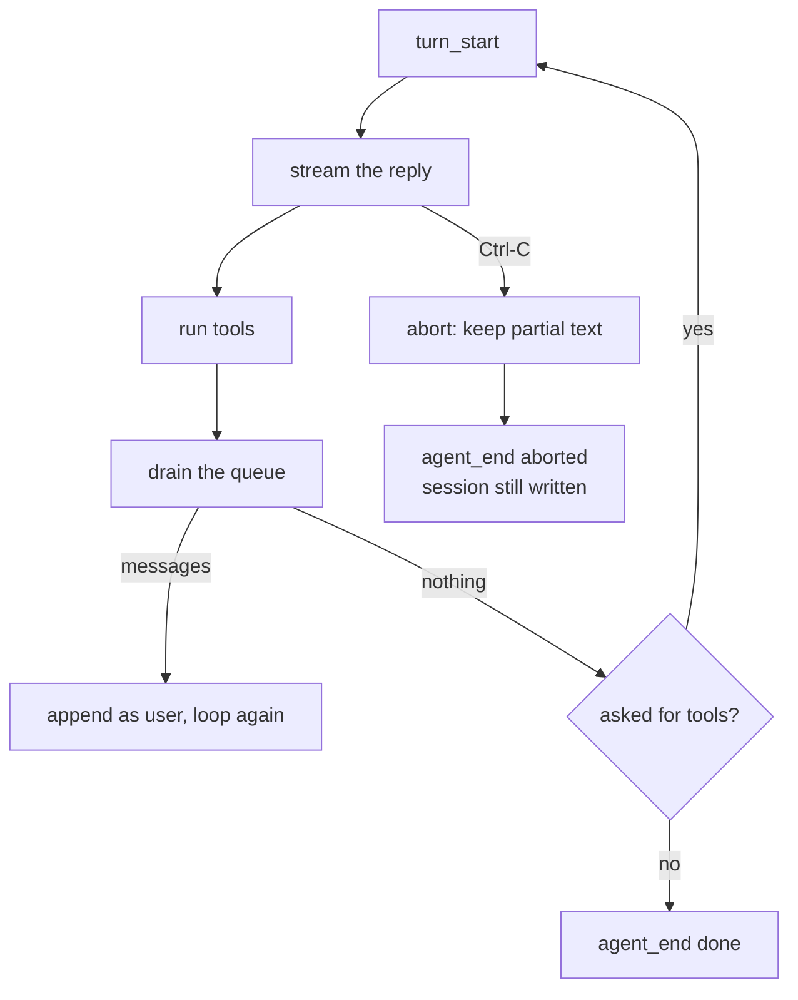

# 09 Steer and abort

**Part IV · Extend** · Difficulty: medium-hard · 75 to 100 minutes · 8 graded cases

## What you are building

An agent you can interrupt, and talk to while it works.

```sh
$ ./agent -p "write a long explanation" | head -5
The first part of a long answer
^C
agent: aborted

$ printf 'also check the tests\n' | ./agent -p "add the flag" -steer-stdin
Added the flag, and the test passes.
```

The first run stops and keeps the text you already read. The second receives a message
typed during the run, and acts on it in the same run.

You edit `agent/loop.go`, `agent/provider_openai.go`, `agent/events.go` and `agent/cmd/agent/main.go`. You also create one new file, `agent/steering.go`, holding the queue.
## Where an interruption lands

A run takes seconds or minutes, with a person in front of it. Two things become
possible: stop it, and say something during it. Both need the same thing, a boundary
where a new event enters without corrupting the conversation. That boundary is the end
of a turn.



## Abort keeps the text

The property is not that the program stops. It is that stopping does not erase what
you already read.

A streaming client accumulates text as it arrives. When the request is cancelled the
read fails part-way. Returning an empty message with the error loses the half-sentence
you were looking at, and makes an interruption look like a crash.

So the parser returns both:

```go
return Message{Role: RoleAssistant, Content: content.String()}, usage,
	fmt.Errorf("read stream: %w", err)
```

and the loop keeps it:

```go
if err != nil {
	if msg.Content != "" {
		history = append(history, msg)
	}
	...
}
```

Three consequences:

| Behaviour | Without it |
|---|---|
| partial text printed | you see an error and lose the answer |
| exit code 130 | a script cannot tell interrupted from failed |
| the turn saved | the next run repeats work you already saw |

130 is 128 plus SIGINT. It is the shell convention, so `if agent -p ...; then` can
reason about it.

## Steering is a boundary

Appending what you typed to the prompt looks fine on a short run and is wrong: the
model answers a prompt you did not type, and the reply addresses a question that was
already being answered.

The end of the turn is the place:

```
  request 1:  system, user("add the flag")
  reply 1:    "I added the flag."
  steer:      "also check the tests"          typed during reply 1
  request 2:  system, user, assistant, user("also check the tests")
```

Two properties follow:

1. **It is a new message, not an edit.** The first request contains none of it.
2. **It keeps the run alive.** If the model said it was done and you then say
   something, the run continues.

```
  done when:  no tool calls  AND  nothing steered
```

That `and` is the whole design.

## The queue

Steering arrives on a goroutine reading stdin and is consumed on the loop's goroutine.
Two rules make it safe:

**Drain takes and clears under a lock.** A queue that is read but not cleared replays
the same instruction every turn.

**Drain never blocks.** A hook that waits for input turns the loop into a program that
waits for a human.

```go
func (s *StdinSteering) Drain() []Message {
	s.mu.Lock()
	defer s.mu.Unlock()
	if len(s.queue) == 0 {
		return nil
	}
	out := s.queue
	s.queue = nil
	return out
}
```

## What you need to build

```go
type LoopOptions struct {
    MaxSteps int
    Emit     Emitter
    Steering func() []Message   // drained at every turn boundary
}

func NewStdinSteering(r io.Reader) *StdinSteering
func (s *StdinSteering) Start()
func (s *StdinSteering) Drain() []Message

const EventSteer = "steer"
```

One flag:

```sh
printf 'also check the tests\n' | agent -p "add a flag" -steer-stdin
```

Exit codes: `0` success, `1` error, `130` interrupted.

## How you are checked

The verifier runs the real binary. For steering it supplies stdin and reads every
request. For abort it starts the process, waits 250 ms, sends SIGINT while the server
is still streaming, then reads stdout, the exit code, the events and the session file.

- `steer-continues-after-done`: a run whose model answered, then received a steered
  line, makes two requests and prints the second answer.
- `steer-enters-after-turn`: request 1 holds no steering text; request 2 is `system,
  user, assistant, user(steer)`.
- `steer-not-duplicated`: one steered line appears exactly once across all requests.
- `no-steer-single-request`: with empty stdin the run costs one request.
- `steer-event-reported`: exactly one `steer` event, carrying the text.
- `abort-keeps-partial`: exit 130, and stdout is a non-empty prefix of the reply.
- `abort-emits-event`: the stream ends with `agent_end` whose reason is `aborted`.
- `abort-persists-session`: the file holds the user message and an assistant record
  with the beginning of the interrupted reply.

## Notes

The parser returns the partial message with the error, not an empty message.

`agent_end` is emitted on every path. The reason field distinguishes the outcomes.

Drain clears, and never blocks.

The done condition gains an `and`.

Persist before returning. A cancelled run still produced turns.

## If you get stuck

<details><summary>First hint: the shape of the problem</summary>

Either the interruption loses the answer, the steered message lands in the wrong place,
or it never arrives.
</details>

<details><summary>Second hint: what you will need</summary>

`context.Canceled`, `errors.Is`, `signal.NotifyContext`, `bufio.Scanner` on a
goroutine, `sync.Mutex`, and a `run` that returns an exit code instead of calling
`os.Exit` directly.
</details>

<details><summary>Third hint: the finished code</summary>

In the parser, return the accumulated message beside the stream error. In the loop, on
error append that partial message when non-empty, emit `agent_end` with reason
`aborted` for a cancellation, and return. After the tool batch, drain steering: emit a
`steer` event per message and append each as a user message. Stop only when the reply
had no tool calls and nothing was steered. In `main`, persist, then on
`context.Canceled` print the partial answer, write `agent: aborted` to stderr, and
return 130.

`miyagi hint 09 <case-id>` prints the same three hints.
</details>

## Done when

`miyagi submit 09` reports 8/8, Ctrl-C during a long answer leaves the text you read on
screen, and a line typed mid-run lands in the next request as its own message.

[example.md](example.md) has the finished code, after you pass.

---

Next: **10 Skills: advertise**.
