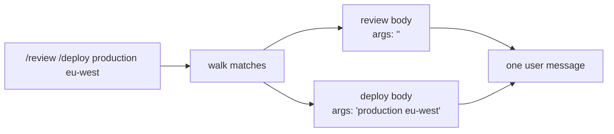

# 10 Overview

*How invocation works. Read this before you write code.*

---

## Invocation is text substitution, not a tool call

A tool call is the model's decision. A skill invocation is the person's: they type
`/deploy staging`, and the agent expands it before the model sees anything.

```
  typed:   /deploy staging eu-west
  sent:    Check the tests pass, then deploy to staging in eu-west.
```

Three consequences:

1. **The model never sees the shorthand.** It sees instructions, which is what it can
   act on.
2. **Expansion happens before the session records the turn.** A resumed run replays
   what was sent, not the shorthand.
3. **An unknown name is passed through.** Deleting the person's text because of a typo
   is worse than sending a slash command the model ignores.

## Placeholders

Two forms, often in one body:

| Placeholder | Replaced with |
|---|---|
| `$ARGUMENTS` | everything after the skill name, as one string |
| `$0`, `$1`, `$2` | one whitespace-separated word, by position |
| `$9` with no argument | the empty string |

Replace `$ARGUMENTS` **first**. Both forms start with `$`, and a positional pass that
runs first can corrupt the longer token.

```
  args:  staging eu-west
  "Deploy to $0 in $1. Full: $ARGUMENTS"
  → "Deploy to staging in eu-west. Full: staging eu-west"
```

Arguments are split on whitespace. Quoting inside an argument is not handled, and this
page says so rather than implying otherwise.

## Stacking

One prompt can name several skills. Arguments run from the skill name to the next
slash command:

```
  "/review /deploy production eu-west"

  review  → arguments: ""                    (nothing before the next command)
  deploy  → arguments: "production eu-west"
```

Expansion walks left to right and preserves order, because the order is the
instruction. "Review, then deploy" and "deploy, then review" are different jobs.



## The catalogue is already there

Chapter 09 handles discovery and advertisement. This chapter adds one method to the
same `Catalog`, and one line in `main` before the prompt becomes history. The system
message does not change, and neither does the loop.

## What this chapter does not do

- **No scripts.** A skill is instructions, not a bundled program.
- **No named arguments.** Only `$ARGUMENTS` and positional.
- **No model-chosen invocation.** The person types the command.

## Self-check

1. Who decides to invoke a skill: the model or the person? *(Invocation is text
   substitution, not a tool call)*
2. Why is `$ARGUMENTS` replaced before `$0`? *(Placeholders)*
3. How are arguments delimited when two skills share a prompt? *(Stacking)*
4. What happens to a skill name that does not exist? *(Invocation is text
   substitution, not a tool call)*
5. Which chapter does discovery, and which does expansion? *(The catalogue is already
   there)*
