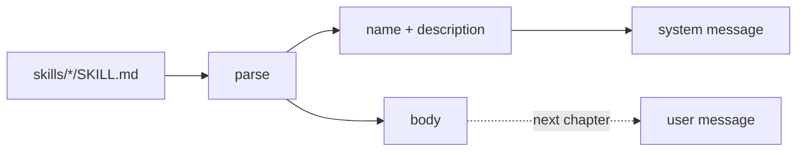

# 10 Skills: advertise

**Part IV · Extend** · Difficulty: easy-medium · 30 to 40 minutes · 4 graded cases

## What you are building

An agent that can see the skills in your repository.

```sh
$ mkdir -p skills/review
$ printf -- '---\nname: review\ndescription: Review the current diff.\n---\nRead the diff and list risks.\n' > skills/review/SKILL.md
$ ./agent -p "what can you do?"
I can review the current diff.
```

The model did not read that file. It read a one-line description the program put in
front of it. The body arrives later, when the skill is used.

You edit `agent/cmd/agent/main.go`. You also create one new file, `agent/skill.go`, holding the parser, the loader and the catalogue.
## One file, two audiences

A skill is a folder with a `SKILL.md`:

```
skills/deploy/SKILL.md
---
name: deploy
description: Deploy the app to a region.
---
Check the tests pass, then deploy to $0 in $1.
```

| Part | Who reads it | When it is sent |
|---|---|---|
| name, description | the model | every request |
| body | the model | only when the skill is invoked |
| the header | your loader | never |

That split is the point. Fifty skills cost fifty lines on every request, not fifty
documents.



## The catalogue is a contributor

The prompt builder from the prompt-assembly chapter takes contributors. The catalogue
is one:

```go
system, err := agent.BuildSystemPrompt(ctx, agent.BasePrompt,
	&agent.AgentsFile{Root: root},
	catalog,
)
```

The builder does not change. The loop does not change.

## The header is not YAML

`name:` and `description:` between `---` fences is enough, and needs no dependency.

Two rules matter more than the format:

**A file that cannot be parsed is skipped.** One broken skill must not stop the agent.

**A missing `skills/` directory is not an error.** Most projects have none.

## What you need to build

```go
type Skill struct {
    Name        string
    Description string
    Body        string
    Path        string
}

func ParseSkill(path string, data []byte) (Skill, error)
func LoadSkills(root string) ([]Skill, error)

type Catalog struct{ /* ... */ }
func NewCatalog(skills []Skill) *Catalog
func (c *Catalog) Contribute(ctx context.Context) (string, error)   // a Contributor
```

## How you are checked

The verifier builds your program, writes a temporary workspace containing `skills/`,
runs the binary, and reads the system message of the request.

- `advertises-skills`: the system message names `deploy` and `review` with their
  descriptions.
- `body-not-advertised`: with the catalogue present, no uninvoked body appears anywhere
  in the request.
- `malformed-skill-skipped`: a `SKILL.md` with no frontmatter is left out, and the run
  succeeds with the valid skill advertised.
- `missing-skills-dir`: with no `skills/` directory the base instruction is sent, there
  is no skills section, and the exit code is 0.

## Notes

Parse the header and keep the body. This chapter does not send it.

Skip a file without a name or a description. It cannot be advertised.

A missing directory is empty, not broken.

Add the catalogue as a contributor to the system prompt and nothing else changes.

## If you get stuck

<details><summary>First hint: the shape of the problem</summary>

Either the catalogue is not in the system message, the files were not found, or a
broken file stopped the run.
</details>

<details><summary>Second hint: what you will need</summary>

`os.ReadDir`, `strings.Cut` for `key: value`, `strings.Index` for the closing fence,
`errors.Is(err, os.ErrNotExist)` for the missing directory.
</details>

<details><summary>Third hint: the finished loader</summary>

`ParseSkill` requires a leading `---`, finds the next `\n---`, reads `key: value` lines
into a map, and takes the rest as the body. It errors when `name` or `description` is
missing. `LoadSkills` reads each `skills/*/SKILL.md`, skips parse errors, returns nil
when the directory is absent, and sorts by name. `Contribute` renders `# Skills`, one
line about how to invoke, then `- name: description` per skill.

`kata hint 10 <case-id>` prints the same three hints.
</details>

## Done when

`kata submit 10` reports 4/4, and a skill file on disk appears in the system message by
name and description.

[example.md](example.md) has the finished code, after you pass.

---

Next: **11 Skills: invoke**.
