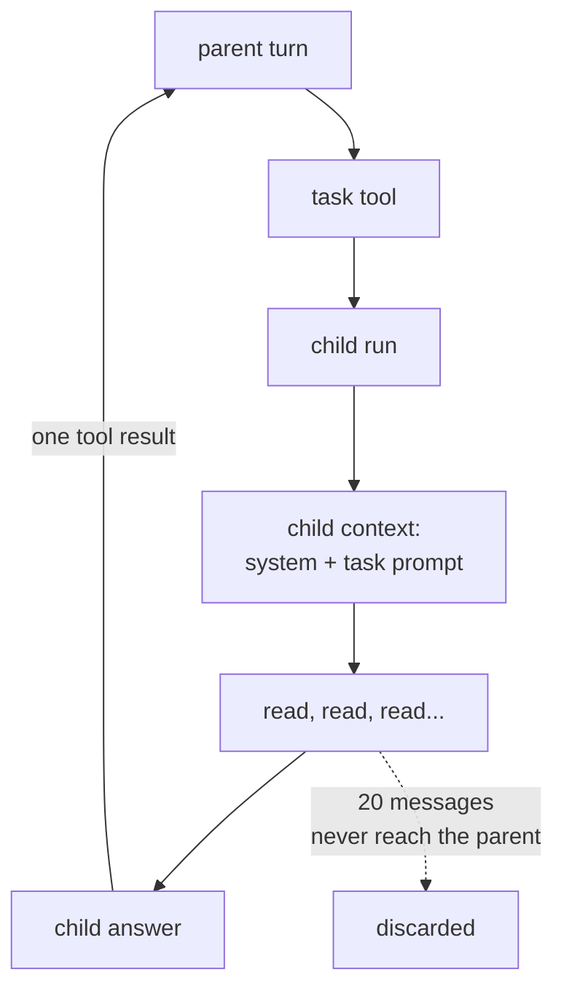

# 10 — Overview

*How subagents work, and what isolation buys. Read this before you write code.*

---

## The problem a child solves

A parent conversation has one budget and one purpose. A task like "find every TODO
and summarise them" produces twenty file reads of detail, and none of it is useful
to the parent once the summary exists. Left in the parent, it costs context for the
rest of the session.

A subagent is a way to spend context in a place that gets thrown away:

```
  parent: "summarise the TODOs"  →  task(prompt)  →  [child: 20 reads]  →  "3 TODOs, all in x"
  parent history grows by:           one tool result
```



The parent's history grows by one result. That is the entire economic argument.

## Isolation means empty, not inherited

The child starts from:

```
  [ system message, task prompt ]
```

Not from the parent's history. Not from a summary of it. Two reasons:

1. **Cost.** Inheriting the parent's conversation makes the child as expensive as
   the parent, and the detail problem is unsolved.
2. **Clarity.** A child told "do this specific thing" is easier to reason about
   than one that has read everything the parent has said.

The consequence is a constraint on whoever writes the task prompt: **the child
cannot see the conversation.** That is why the prompt has to be complete, and why
the tool description says so. A model told to "fix it" without being told what
"it" is produces a confident wrong answer.

## Recursion is prevented by the registry, not by a rule

The dangerous version of this feature is a child that can spawn children. Two
levels of fan-out turn one request into a tree, and the request count explodes
before anyone notices.

There are two ways to prevent it:

| Approach | Behaviour |
|---|---|
| a depth counter, checked at runtime | a bug in the check is a runaway |
| the tool is absent from the child's registry | impossible |

This chapter uses the second. The child's registry is built before the task tool
exists:

```go
base := []Tool{read, write, bash}
child := NewRegistry(base...)                       // no task
parent := NewRegistry(append(base, task)...)        // task, once
```

The child still has real tools, because a subagent that cannot read a file cannot
summarise a repository. The restriction is on delegation, not on work.

## One call, one result, every time

The parent is blocked inside a tool call. Whatever the child does, that call has to
resolve:

| Child outcome | Parent receives |
|---|---|
| answered | the answer text |
| hit its step cap | an error result naming the cap |
| provider failed | an error result naming the failure |
| returned empty | an error result |

An unresolved call is not a degraded conversation, it is an invalid one: providers
reject a tool call with no result. So the failure path is part of the contract, not
an afterthought.

Returning `("", err)` from `Execute` is enough, because `Registry.Run` already
converts an error into an `IsError` result. Writing a success result *and* returning
an error is how a call gets two results, which is the case `exactly-one-result`
catches.

## The parent blocks, and that is a design choice

This chapter runs the child synchronously: the parent's turn waits.

The alternative is a background child that returns a receipt and delivers its answer
later as a separate message. That is what real harnesses do for long jobs, and it is
strictly harder:

- the result arrives when no call is waiting for it;
- the parent needs a queue and an ordering rule;
- an interrupted parent has a child that is still running.

Sync first is the right order for learning. You cannot debug the async version
without having seen the simple one.

## What this chapter does not do

- **No parallel children.** One task call runs one child, in order. Two calls in one
  message run one after the other.
- **No background delivery.** The parent waits.
- **No per-child model or budget.** The child uses the same provider and the same
  context ceiling as the parent, with a smaller step cap.
- **No child events.** The child's turns emit into the same event stream, so a
  consumer sees a flat sequence with no indication of nesting.

That last gap is honest and visible: the event stream from a parent with a child
looks like one long run.

## Where the real implementations go further

| Concern | Implementation |
|---|---|
| Background children with receipts | pi subagent extensions |
| Fan-out limits and scheduling | pi-subagent-manager |
| Inherited context, as an opt-in | some extensions, via a transcript prefix |
| Depth limits when the registry is shared | depth counters in the loop |

One warning from the survey: an extension advertising "inherit context" may only
prefix the child's prompt with a text transcript, which is not the same as a session
fork. If you build that later, decide which one you mean.

## Self-check

1. What does the parent's history grow by, and what does that buy?
   *(The problem a child solves)*
2. Why does the child start empty rather than inheriting a summary?
   *(Isolation means empty, not inherited)*
3. How is recursion prevented, and why is that better than a depth check?
   *(Recursion is prevented by the registry, not by a rule)*
4. Name four child outcomes and what the parent receives for each.
   *(One call, one result, every time)*
5. Why is synchronous the right first version? *(The parent blocks, and that is a
   design choice)*
