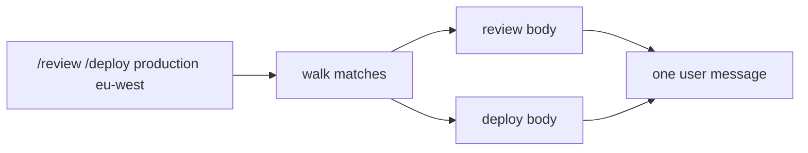

# 11 Skills: invoke

**Part IV · Extend** · Difficulty: medium · 30 to 50 minutes · 6 graded cases

## What you are building

An agent that runs the skills you wrote.

```sh
$ ./agent -p "/deploy staging eu-west"
Deploying to staging in eu-west. Tests pass, release tagged v1.4.2.
```

The model never saw `/deploy`. It received the skill's body with the arguments filled
in.

You may edit `agent/skill.go` and `agent/cmd/agent/main.go`.

## Text substitution, not a tool call

A tool call is the model's decision. A skill invocation is yours: you type
`/deploy staging`, and the program expands it before the model sees anything.

```
  typed:   /deploy staging eu-west
  sent:    Check the tests pass, then deploy to staging in eu-west.
```

Three consequences:

1. The model never sees the shorthand. It sees instructions.
2. Expansion happens before the turn is recorded, so a resumed session replays what was
   sent.
3. An unknown name passes through. Deleting your text because of a typo is worse than
   sending a command the model ignores.

## Placeholders

| Placeholder | Replaced with |
|---|---|
| `$ARGUMENTS` | everything after the skill name, as one string |
| `$0`, `$1`, `$2` | one whitespace-separated word, by position |
| `$9` with no argument | the empty string |

Replace `$ARGUMENTS` first. Both forms start with `$`.

```
  args:  staging eu-west
  "Deploy to $0 in $1. Full: $ARGUMENTS"
  → "Deploy to staging in eu-west. Full: staging eu-west"
```

Arguments are split on whitespace. Quoting inside an argument is not handled.

## Stacking

One prompt can name several skills. Arguments run from the skill name to the next slash
command:

```
  "/review /deploy production eu-west"

  review  → arguments: ""                    nothing before the next command
  deploy  → arguments: "production eu-west"
```

Expansion walks left to right and preserves order, because the order is the
instruction.



## What you need to build

```go
type Expansion struct {
    Name string
    Args string
}

func (c *Catalog) Expand(prompt string) (string, []Expansion)
```

One line in `main`, before the prompt becomes history:

```go
userText, _ := catalog.Expand(*prompt)
```

## How you are checked

The verifier builds the program with `skills/` present, runs it with a prompt
containing slash commands, and reads the user message of the request.

- `loads-body-on-invoke`: `/deploy staging eu-west` puts the body in the user message.
- `substitutes-arguments`: `$0`, `$1` and `$ARGUMENTS` are replaced, and no placeholder
  survives.
- `stacks-skills`: `/review /deploy production eu-west` expands both, review first,
  with deploy's own arguments applied.
- `no-invocation-no-body`: an ordinary prompt arrives byte-identical and no body is
  sent.
- `unknown-skill-preserved`: `/nosuch please help` keeps the original text, and the
  program still answers.
- `frontmatter-not-leaked`: the expanded body is present, and neither `---` nor
  `description:` appears in it.

## Notes

Replace `$ARGUMENTS` before `$0`.

Arguments end at the next slash command, so several skills share a prompt.

Preserve unknown commands verbatim.

Expand before recording the turn.

Do not reformat the rest of the prompt. Only recognised commands change.

## If you get stuck

<details><summary>First hint: the shape of the problem</summary>

Either the command was not recognised, the arguments were cut at the wrong place, or a
placeholder survived.
</details>

<details><summary>Second hint: what you will need</summary>

`regexp` with `(^|\s)/([a-z0-9][a-z0-9-]*)` for commands, `strings.Fields` for
arguments, and `regexp.ReplaceAllStringFunc` for `\$(\d+)`.
</details>

<details><summary>Third hint: the finished walk</summary>

`Expand` finds every command, takes the text up to the next command as its arguments,
and writes either the expanded body or the original text. `expandBody` replaces
`$ARGUMENTS` first, then each positional match against the whitespace-split arguments,
substituting the empty string when the index is out of range.

`miyagi hint 11 <case-id>` prints the same three hints.
</details>

## Done when

`miyagi submit 11` reports 6/6, and `/deploy staging eu-west` sends the body with the
arguments applied.

[example.md](example.md) has the finished code, after you pass.

---

Next: **12 Subagent**.
