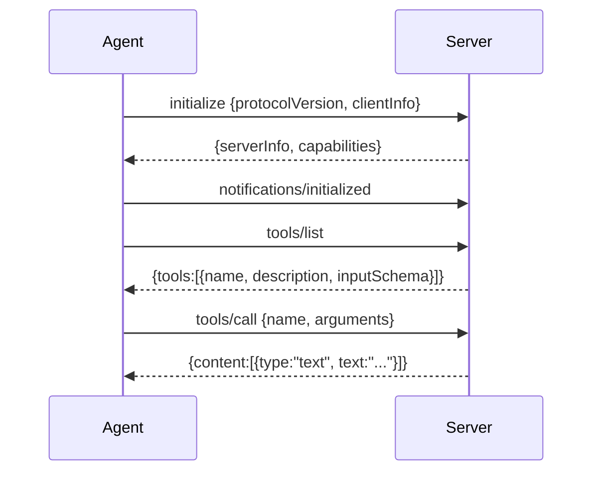

# 11 Overview

*How MCP works over stdio. Read this before you write code.*

---

## The whole protocol is a pipe and lines

MCP is often described in terms of capabilities, resources, prompts, and sampling.
The transport underneath is smaller than any of that:

```
  your process                            server process
  ────────────                            ──────────────
  spawn ───────────────────────────────▶  starts
  write {"jsonrpc":"2.0","id":1,"method":"initialize",...}\n
                                          read a line, answer
  ◀────────────────────────────────────── {"jsonrpc":"2.0","id":1,"result":{...}}\n
```

One JSON object per line. Requests carry an `id`; the response carries the same
`id`. Notifications have no `id` and get no response. That is the framing.



Three details that cost time if you get them wrong:

- **`initialize` is a request.** It has an id and you wait for the answer.
- **`notifications/initialized` is a notification.** No id, no response. Strict
  servers wait for it before answering anything else.
- **Responses and notifications share the stream.** A reader that assumes the next
  line is its answer will hang the first time the server sends a log notification.

## Why the server's name is in the tool name

A server may expose a tool called `read`. So does the agent. If the names collide,
the server's version silently replaces the built-in one, and a file the model
believes it read from disk came from somewhere else.

Namespacing removes the ambiguity:

```
  built-in:   read          write          bash          task
  server:     demo.read     demo.echo
```

The prefix is the server's own reported name, sanitised to lowercase and dashes. If
the server reports nothing usable, `mcp` is the fallback. The important property is
that the name is derived, not hardcoded, so two servers with a `read` do not fight.

## Adapters, not special cases

The registry already dispatches by name, the loop already appends results, and the
prompt already lists schemas. A server tool becomes ordinary the moment it satisfies
the `Tool` interface:

```go
func (t *mcpTool) Name() string                  { return t.server + "." + t.info.Name }
func (t *mcpTool) Parameters() map[string]any    { return t.info.InputSchema }
func (t *mcpTool) Execute(ctx, input) (string, error) {
	return t.client.CallTool(ctx, t.info.Name, input)
}
```

Nothing in the loop changed to support MCP. That is the last time the course makes
this point, and it is the reason the previous eleven chapters built seams.

## Content is a list, not a string

A `tools/call` result carries content blocks:

```json
{"content": [
  {"type": "text", "text": "echo: hello"},
  {"type": "text", "text": "(second block)"}
]}
```

Two rules:

- **Join the text blocks.** Taking only the first loses most answers.
- **Ignore types you cannot use.** An image block is base64 that would spend the
  context budget on something the model cannot see here.

A server can also set `isError: true` on a successful response. That is a tool that
ran and failed, and it becomes an error result like any other.

## Failure has two shapes

| Failure | Response | Agent behaviour |
|---|---|---|
| the server will not start | no process | warn on stderr, continue without its tools |
| the handshake fails | no valid `initialize` answer | warn, continue |
| the server refuses a call | JSON-RPC `error` object | error result, session continues |
| the server dies mid-run | EOF on the pipe | error result for the call in flight |

The first two are startup problems, and the agent is still useful without the
extension. The last two are per-call problems, and the model can read them.

An optional extension that stops the whole program is a bad trade. A person asked a
question; they did not ask for a working plugin.

## Synchronous, one call at a time

This client serialises requests: send, wait, return. That is enough because the loop
runs tools in order.

The version that scales sends several calls at once and matches responses by id.
That needs a reader goroutine, a map of pending ids, and a rule for what happens when
a response arrives for a call whose context was cancelled. It is a real design, and
it is a chapter on its own.

## What this chapter does not do

- **No HTTP or SSE transport.** stdio only.
- **No resources, prompts, or sampling.** Tools are the part a coding agent uses.
- **No reconnection.** If the server dies, its tools return errors for the rest of
  the run.
- **No MCP tools for subagents.** The child registry is built from built-in tools,
  which also keeps the child's schema list small.

## Where the real implementations go further

| Concern | Implementation |
|---|---|
| Official Go SDK | crush `internal/mcp` |
| Hand-rolled JSON-RPC | pi and PiG MCP clients |
| Server lifecycle and restart | crush `internal/mcp` |
| Lazy tool schemas for many servers | toolflow, stage-gated mounting |

The survey behind this course found both approaches in production: crush delegates to
the official SDK, pi hand-rolls the framing. This chapter hand-rolls it because the
framing is the lesson, and because a dependency would hide the forty lines that
matter.

## Self-check

1. What is the framing, and how do you tell a request from a notification?
   *(The whole protocol is a pipe and lines)*
2. Which two requests must happen before `tools/call`, in what order?
   *(The whole protocol is a pipe and lines)*
3. Why is the server's name part of the tool name? *(Why the server's name is in the
   tool name)*
4. What does the loop know about MCP? *(Adapters, not special cases)*
5. Which two failures are startup problems, and which two are per-call problems?
   *(Failure has two shapes)*
