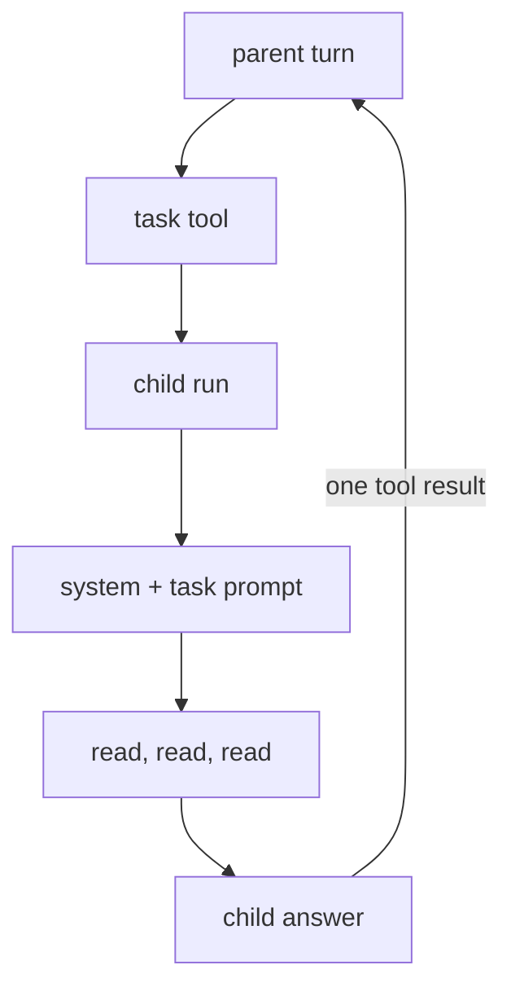

# 12 Subagent

**Part V · Compose** · Difficulty: hard · 90 to 120 minutes · 8 graded cases

## What you are building

An agent that can hand a whole job to a second copy of itself.

```sh
$ ./agent -p "find every TODO in this repo and summarise them; use a subagent"
Three TODOs: two in the loop, one in the README.
```

The parent asked once. The child read twenty files. The parent's conversation grew by
one message.

You may edit `agent/subagent.go` and `agent/cmd/agent/main.go`.

## Why a child

A parent conversation has one budget and one purpose. "Find every TODO" produces
twenty file reads of detail, and none of it is useful once the summary exists. Left in
the parent, it costs context for the rest of the session.

A subagent spends context in a place that gets thrown away.



## Isolation means empty, not inherited

The child starts from two messages:

```
  [ system, task prompt ]
```

Not the parent's history, and not a summary of it. Inheriting makes the child as
expensive as the parent and leaves the detail problem unsolved.

The consequence is a rule for whoever writes the task prompt: the child cannot see the
conversation. A prompt that says "fix it" produces a confident wrong answer, which is
why the tool description says so.

## Recursion, prevented by the registry

A child that can spawn children turns one request into a tree. Two ways to stop it:

| Approach | Behaviour |
|---|---|
| a depth counter checked at runtime | a bug in the check is a runaway |
| the tool is absent from the child's registry | impossible |

The second one:

```go
base := []Tool{read, write, bash}
child := NewRegistry(base...)                    // no task
parent := NewRegistry(append(base, task)...)     // task, once
```

The child still has real tools, because a subagent that cannot read a file cannot
summarise a repository. The restriction is on delegation.

## One call, one result

The parent is blocked inside a tool call. Whatever the child does, that call resolves:

| Child outcome | Parent receives |
|---|---|
| answered | the answer text |
| hit its step cap | an error result naming the cap |
| provider failed | an error result naming the failure |
| returned nothing | an error result |

An unresolved call is not a degraded conversation, it is an invalid one. Returning
`("", err)` is enough, because the registry turns an error into an error result.
Returning text and an error together is how a call gets two results.

## The parent waits

This chapter runs the child synchronously. The alternative is a background child that
returns a receipt and delivers its answer later, which needs a queue, an ordering rule,
and a decision about an interrupted parent with a child still running.

## What you need to build

```go
const DefaultSubagentSteps = 8

type TaskTool struct {
    Provider StreamingProvider
    Tools    *Registry   // must not contain a TaskTool
    System   string
    MaxSteps int
}

func (t *TaskTool) Name() string        // "task"
func (t *TaskTool) Execute(ctx context.Context, input json.RawMessage) (string, error)
```

Arguments: `{"description": string, "prompt": string}`, with `prompt` required.

Construction order matters:

```go
base   := []agent.Tool{read, write, bash}
child  := agent.NewRegistry(base...)                          // no task tool
task   := &agent.TaskTool{Provider: provider, Tools: child, System: system}
parent := agent.NewRegistry(append(base, task)...)            // task, once
```

## How you are checked

The verifier builds the program and scripts a conversation that crosses both runs: a
parent turn that delegates, the child's turns, then the parent's next turn. It reads
every request and tells parent from child by shape.

- `task-tool-advertised`: the parent's request advertises `task`.
- `child-gets-fresh-context`: the child's request has exactly two messages, a system
  message and the task prompt, and none of the parent's text.
- `child-cannot-recurse`: the child's request does not advertise `task`, and it is a
  real child request.
- `result-returned-to-parent`: the parent's next request carries the child's answer as
  the result for the call id.
- `exactly-one-result`: that call has exactly one result, and it is not an unknown-tool
  error.
- `child-uses-tools`: the child reads a file, and its answer reaches the parent.
- `child-failure-is-a-result`: a child that exhausts its step cap produces an error
  result naming the cap, and the parent still exits 0.
- `parent-continues-after-task`: two delegations complete, and the parent prints its own
  answer after five requests.

## Notes

The child's registry defines what it can do. Leave `task` out and recursion is
impossible.

Fresh means two messages.

Return the answer from `Execute`. The registry makes it the tool result, and turns an
error into an error result.

Never return text and an error together.

Include the partial answer in a child failure. A half-finished child is informative.

## If you get stuck

<details><summary>First hint: the shape of the problem</summary>

Either the child inherited too much, the child could delegate again, or the parent's
call did not resolve.
</details>

<details><summary>Second hint: what you will need</summary>

`RunLoop` with a two-message history, `NewRegistry(base...)` before the task tool
exists, `append(base, task)` for the parent, `fmt.Errorf` with `%w` to keep the child's
error inspectable.
</details>

<details><summary>Third hint: the finished tool</summary>

`TaskTool.Execute` parses `prompt`, builds `[{system}, {user prompt}]`, calls `RunLoop`
with `MaxSteps`, and returns the final content. On error it returns an error naming the
step count and the partial answer. In `main`, build the base tools, the child registry,
the task tool with the provider and system message, then the parent registry as base
plus task.

`kata hint 12 <case-id>` prints the same three hints.
</details>

## Done when

`kata submit 12` reports 8/8, and asking the agent to use a subagent produces requests
that never appear in the parent's history.

[example.md](example.md) has the finished code, after you pass.

---

Next: **13 MCP**.
