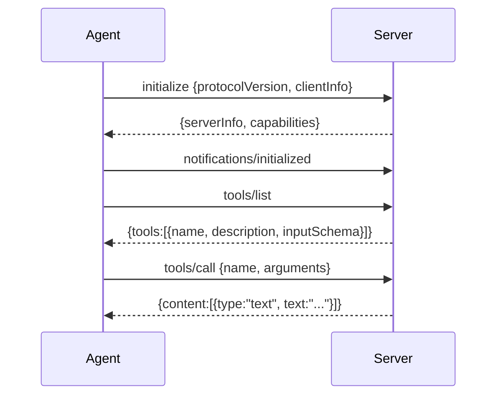

# 13 MCP

**Part V · Compose** · Difficulty: hard · 90 to 120 minutes · 8 graded cases

## What you are building

An agent that calls tools living in another process.

```sh
$ ./agent -p "echo hello through the server" -mcp "/path/to/server"
The server said: echo: hello
```

The tool was never compiled into your program. A server process described it, and your
program offered it to the model.

You edit `agent/cmd/agent/main.go`. You also create one new file, `agent/mcp.go`, holding the client, the JSON-RPC framing and the tool adapter.
## A pipe and lines

MCP is described in terms of capabilities, resources and sampling. The transport is
smaller than any of that:

```
  your process                              server process
  ────────────                              ──────────────
  spawn ──────────────────────────────────▶ starts
  write {"jsonrpc":"2.0","id":1,"method":"initialize",...}\n
                                            read a line, answer
  ◀──────────────────────────────────────── {"jsonrpc":"2.0","id":1,"result":{...}}\n
```

One JSON object per line. A request carries an `id`; the response carries the same
`id`. A notification has no `id` and gets no response.



Three details:

**`initialize` is a request.** It has an id, and you wait for the answer.

**`notifications/initialized` is a notification.** No id, no response. A strict server
waits for it before answering anything else.

**Responses and notifications share the stream.** A reader that assumes the next line
is its answer hangs the first time the server sends a log message.

## Names come from the server

A server may expose a tool called `read`, and so does your program. If the names
collide, the server's version silently replaces the built-in one, and a file the model
believes it read from disk came from somewhere else.

```
  built-in:   read          write          bash          task
  server:     demo.read     demo.echo
```

The prefix is the server's reported name, lowercased and reduced to letters, digits and
dashes. If the server reports nothing usable, `mcp` is used.

## The adapter is an ordinary tool

The registry dispatches by name, the loop appends results, and the prompt lists
schemas. A server tool becomes ordinary once it satisfies the interface:

```go
func (t *mcpTool) Name() string               { return t.server + "." + t.info.Name }
func (t *mcpTool) Parameters() map[string]any { return t.info.InputSchema }
func (t *mcpTool) Execute(ctx, input) (string, error) {
	return t.client.CallTool(ctx, t.info.Name, input)
}
```

The loop did not change to support this.

## Content is a list

A `tools/call` result carries blocks:

```json
{"content": [
  {"type": "text", "text": "echo: hello"},
  {"type": "text", "text": "(second block)"}
]}
```

Join the text blocks, or you lose most answers. Ignore types you cannot use, because an
image block is base64 that would spend the context budget on something the model cannot
see.

A server can also set `isError: true` on a successful response. That is a tool that ran
and failed, and it becomes an error result.

## Failure has four shapes

| Failure | Response | Behaviour |
|---|---|---|
| the server will not start | no process | warn on stderr, continue without its tools |
| the handshake fails | no valid answer | warn, continue |
| the server refuses a call | JSON-RPC `error` object | error result, the run continues |
| the server dies mid-run | end of the pipe | error result for the call in flight |

The first two are startup problems, and the agent is still useful without the
extension. The last two are per-call problems, and the model can read them.

## What you need to build

```go
const MCPProtocolVersion = "2024-11-05"

type MCPClient struct{ /* ... */ }

func StartMCP(ctx context.Context, command string) (*MCPClient, error)
func (c *MCPClient) Initialize(ctx context.Context) error
func (c *MCPClient) ListTools(ctx context.Context) error
func (c *MCPClient) CallTool(ctx context.Context, name string, args json.RawMessage) (string, error)
func (c *MCPClient) Tools() []Tool
func (c *MCPClient) ServerName() string
func (c *MCPClient) Close() error
```

One flag:

```sh
agent -p "..." -mcp "/path/to/server"
```

## How you are checked

The verifier builds your program and a scripted MCP server. It runs the agent with
`-mcp` pointing at that server, then reads two traces: the HTTP requests to the model,
and the server's own method log.

- `mcp-tools-advertised`: the request advertises `read`, `write`, `bash`, `task`,
  `demo.echo` and `demo.read`.
- `mcp-initialize-handshake`: the server received `initialize`,
  `notifications/initialized`, `tools/list`, in that order.
- `mcp-tool-call`: a call to `demo.echo` reaches `tools/call` and its text comes back as
  the result.
- `mcp-content-blocks-joined`: both text blocks appear in the result.
- `mcp-name-collision`: `demo.read` returns the server's content while `read` remains
  the built-in.
- `mcp-error-is-a-result`: a JSON-RPC error becomes an error result, and the run exits 0.
- `mcp-unavailable-is-survivable`: a server that cannot start produces a warning, no MCP
  tools, and still answers.
- `mcp-no-call-when-unused`: a plain run performs no `tools/call`.

## Notes

One JSON object per line. Requests have an id, notifications do not.

Skip responses whose id is not yours.

Namespace by the server's name.

Join text blocks and ignore types you cannot use.

A JSON-RPC error becomes a Go error, which the registry turns into an error result.

Startup failure is a warning, not an exit.

## If you get stuck

<details><summary>First hint: the shape of the problem</summary>

Either the handshake order is wrong, the response reader is confused by notifications,
or the tool names collide.
</details>

<details><summary>Second hint: what you will need</summary>

`exec.CommandContext` with `StdinPipe` and `StdoutPipe`,
`bufio.Reader.ReadBytes('\n')`, `encoding/json` per line, `cmd.Process.Kill` on close.
</details>

<details><summary>Third hint: the finished client</summary>

`StartMCP` runs `sh -c <command>` and keeps stdin and stdout. `call` writes a request
with an id and reads lines until one carries that id, skipping notifications.
`Initialize` sends `initialize`, records `serverInfo.name`, then sends
`notifications/initialized`. `ListTools` decodes the tool list. `CallTool` sends
`tools/call` with the original name and joins the text blocks. `mcpTool` adapts one
entry. In `main`, warn and continue when the server cannot start.

`miyagi hint 13 <case-id>` prints the same three hints.
</details>

## Done when

`miyagi submit 13` reports 8/8, and the agent calls a tool that lives in another process.

[example.md](example.md) has the finished code, after you pass.

---

Next: **14 Retries and rate limits**.
