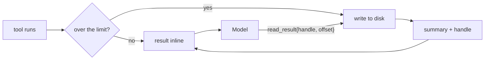

# 15 Bounding a tool result

**Part VI · Operate** · Difficulty: medium-hard · 60 to 80 minutes · 7 graded cases

## What you are building

An agent that reads a large file without spending its whole budget on it.

```sh
$ ./agent -p "read big.txt and tell me how many lines it has"
The first 8000 bytes are inline...
... [moved to disk: 20044 bytes, 5001 lines in total]
handle: 3f2a91c4b7de0011
Read it with the read_result tool: {"handle": "3f2a91c4b7de0011", "offset": 8000}
5001 lines.
```

The model received a summary, the beginning, and a way to ask for more.

You edit `agent/cmd/agent/main.go`. You also create one new file, `agent/spill.go`, holding the store, the handle and the `read_result` tool.
## Why not just cut it

The previous chapters cap output at 20,000 bytes. That keeps the budget and loses the
information: a model that receives the first 20 KB of a 200 KB log does not know what
the last 180 KB said, and cannot find out.

Moving the content to disk keeps both. The model gets a summary and a handle, and a
second tool returns any slice of it.



## The handle

Content-addressed, so the same output reuses the same file:

```
  sha256(content) → 3f2a91c4b7de0011...
  path            → <root>/.agent-results/3f2a91c4b7de0011.txt
```

Short enough to sit in a message, and derived rather than random so a re-run of the same
command does not fill the directory with copies.

## The notice

Three facts, or the handle is useless:

```
... [moved to disk: 20044 bytes, 5001 lines in total]
handle: 3f2a91c4b7de0011
Read it with the read_result tool: {"handle": "3f2a91c4b7de0011", "offset": 8000}
```

How much exists, what to call it, and the exact call that continues from where the
inline part stopped. Without the third line the model has a name and no instructions.

## The handle is untrusted

It arrives as a model argument, like a path does. Accept only plain hexadecimal and
build the filename yourself:

```go
for _, r := range handle {
	switch {
	case r >= '0' && r <= '9':
	case r >= 'a' && r <= 'f':
	default:
		return "", fmt.Errorf("invalid handle: %q", handle)
	}
}
```

A handle of `../../../etc/passwd` never reaches the filesystem.

## What you need to build

```go
const DefaultSpillLimit = 8_000
const DefaultSliceBytes = 8_000

type SpillStore struct{ Dir string }

func (s *SpillStore) Put(name, content string, limit int) (string, bool, error)
func (s *SpillStore) Get(handle string, offset, length int) (string, int, error)

type ReadResultTool struct{ Store *SpillStore }   // a Tool
```

One flag:

```sh
agent -p "..." -spill-bytes 8000
```

## How you are checked

The verifier builds your program, runs it in a temporary workspace with a large file,
and reads what reached the model along with the file on disk.

- `small-result-passes-through`: a short result arrives unchanged.
- `large-result-moved`: a 50 KB result becomes a short summary with a notice and a
  handle.
- `result-written-to-disk`: the whole result exists under the handle.
- `read-result-fetches-a-slice`: `read_result` returns the first 100 bytes with a note
  naming the range.
- `unknown-handle-is-a-result`: a handle with no file produces a readable result.
- `offset-past-end-is-a-result`: an offset past the end names the real size.
- `handle-is-not-a-path`: a handle containing `../` is refused, and no file leaks.

## Notes

Keep the first slice inline. A model that has to make a second call before it can start
working is slower at everything.

The read tool already caps its own output, so what spills is the capped text. The
property here is that the bytes exist, not that they match the original file.

Return the total size with every slice, so the model can plan.

## If you get stuck

<details><summary>First hint: the shape of the problem</summary>

Either the content was cut instead of moved, the handle cannot be followed, or the
handle can reach a file it should not.
</details>

<details><summary>Second hint: what you will need</summary>

`crypto/sha256` and `encoding/hex` for the handle, `os.WriteFile` and `os.Open`,
`f.ReadAt` for slices, `os.Stat` for the size.
</details>

<details><summary>Third hint: the finished store</summary>

`Put` returns the content unchanged when it fits. Otherwise it hashes the content, writes
it under the handle, and returns the first `limit` bytes plus a notice naming the size,
the line count, the handle and the next call. `Get` validates the handle as hex, opens
the file, compares the offset with the size, and reads with `ReadAt`. `ReadResultTool`
formats the slice with a note naming the byte range and the next offset.

`kata hint 15 <case-id>` prints the same three hints.
</details>

## Done when

`kata submit 15` reports 7/7, and a 50 KB result reaches the model as a summary it can
follow up.

[example.md](example.md) has the finished code, after you pass.

---

Next: **16 The tool schema budget**.
