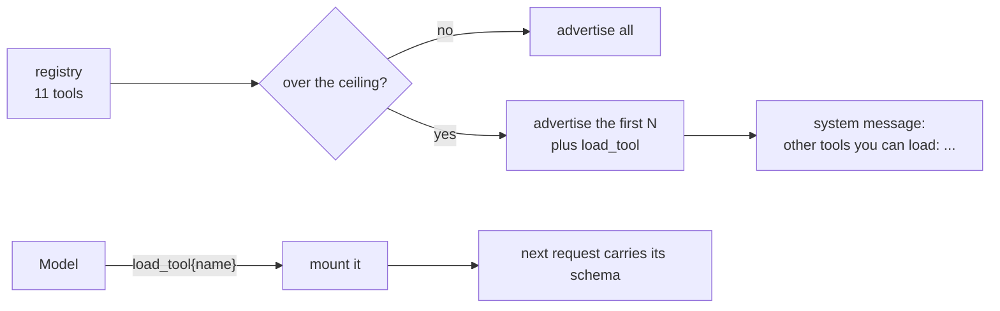

# 16 The tool schema budget

**Part VI · Operate** · Difficulty: medium-hard · 60 to 80 minutes · 7 graded cases

## What you are building

An agent that can have more tools than it can afford to describe.

```sh
$ ./agent -p "count the lines in every Go file" -max-tools 4
The four Go files have 812 lines in total.
```

The registry knows eleven tools. The request advertised four, and named the rest so the
model could ask for one.

You edit `agent/cmd/agent/main.go`. You also create one new file, `agent/mount.go`, holding the ceiling, the mount set and the `load_tool` tool.
## The cost of a tool

Every request carries the schema of every tool it advertises: name, description, and the
JSON Schema for the arguments. That is paid on every turn, whether or not the model
calls anything.

In one measured harness, thirteen tools accounted for 15,560 bytes of a 23,884 byte
request. Two thirds of the request was definitions, before any conversation existed.

So a project with twenty tools pays twenty definitions per turn. The fix is not to
delete them, it is to describe fewer and keep the rest reachable.



## Three things have to be true

**The ceiling holds.** No request advertises more than the limit.

**The loader is exempt.** If the ceiling could hide the tool that loads tools, nothing
hidden would ever be reachable again.

**The hidden ones have names.** A tool that can only be loaded by guessing is never
loaded, so the system message lists them.

```
Other tools you can load with load_tool: write, bash, task, read_result
```

## Mounting is permanent

Once mounted, a tool stays advertised. The alternative is a mount that lasts one turn,
and a model that reloads the same tool on every step.

```
  turn 1:  read, write, load_tool
  load_tool{name: "bash"}
  turn 2:  read, write, bash, load_tool
  turn 3:  read, write, bash, load_tool        still there
```

## The two budgets meet here

The context budget counts tool schemas. This chapter is the only way to lower that
number, so the estimate has to be computed from the schemas actually advertised, not
from the registry.

## What you need to build

```go
const DefaultMaxTools = 6

type Mounted struct{ /* ... */ }

func NewMounted(all *Registry, max int) *Mounted
func (m *Mounted) Mounted() []ToolDef
func (m *Mounted) Mount(name string) bool
func (m *Mounted) Always(name string)
func (m *Mounted) Names() []string
func (m *Mounted) ToolList() string

type ToolLoader struct{ Mounted *Mounted }   // a Tool
```

One flag:

```sh
agent -p "..." -max-tools 4
```

## How you are checked

The verifier builds your program, runs it with a ceiling, and reads the advertised tools
and the system message.

- `ceiling-respected`: with `-max-tools 3`, at most three tools are advertised.
- `hidden-tools-are-named`: the system message mentions `load_tool` and names at least
  three of the hidden tools.
- `load-tool-is-always-advertised`: with `-max-tools 1`, `load_tool` is still there.
- `loading-a-tool-makes-it-callable`: after `load_tool{name:"read"}`, the next request
  advertises `read`.
- `unknown-tool-load-is-a-result`: loading a name that does not exist produces a readable
  result.
- `no-ceiling-advertises-everything`: with `-max-tools 50`, everything is advertised.
- `schemas-still-count-against-budget`: nine tools estimate higher than two.

## Notes

Registration order decides which tools are advertised, so it is a policy and not an
accident. Keep the always-useful tools first.

A registry smaller than the ceiling advertises everything and behaves as it did before.

The loader needs a way to check a name exists before mounting it, or a typo creates a
permanently advertised tool that can never run.

## If you get stuck

<details><summary>First hint: the shape of the problem</summary>

Either too many schemas go out, the loader got hidden, or a loaded tool does not appear
on the next turn.
</details>

<details><summary>Second hint: what you will need</summary>

A set of mounted names, `sort.Strings` for stable output, and a filtered `[]ToolDef`.
</details>

<details><summary>Third hint: the finished wrapper</summary>

`Mounted()` returns the always-on names first, then registration order up to the
ceiling, then anything explicitly mounted. `Mount` checks the name exists and records
it. `ToolList` returns one line naming what is hidden. `ToolLoader.Execute` validates the
name, mounts it, and says so. In `main`, append the loader, wrap the registry, and add
the tool list line to the system message.

`kata hint 16 <case-id>` prints the same three hints.
</details>

## Done when

`kata submit 16` reports 7/7, and a project with more tools than the ceiling still lets
the model reach all of them.

[example.md](example.md) has the finished code, after you pass.

---

Next: **17 Skill scopes and precedence**.
