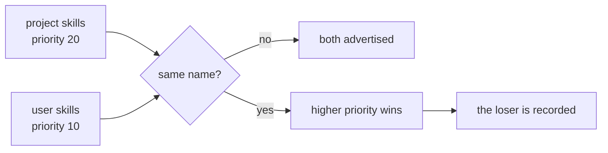

# 17 Skill scopes and precedence

**Part VI · Operate** · Difficulty: medium · 45 to 60 minutes · 6 graded cases

## What you are building

An agent that reads skills from more than one place, and knows which copy wins.

```sh
$ cat skills/deploy/SKILL.md       # in this repository
Deploy to $0 using the staging cluster.

$ $XDG_CONFIG_HOME/kata/skills/deploy/SKILL.md
Deploy to $0.                     # a general version, from your machine

$ ./agent -p "/deploy eu-west"
Deploying to eu-west using the staging cluster.
```

Two files, one name. The repository's copy is the one that ran, and the catalogue said
so.

You edit `agent/cmd/agent/main.go`. You also create one new file, `agent/scoped.go`, holding the scopes, the precedence rule and the resolution.
## Why more than one directory

Skills live at two levels for the same reason configuration does. A repository's skills
know about that codebase. A person's skills follow them between projects. Both are
useful, and they will eventually collide on a name, because "deploy" and "review" are
the obvious names for anything.

Precedence is the answer, and it has to be a decision in the code rather than an accident
of directory order.



## The rules

1. A scope whose directory does not exist contributes nothing.
2. A malformed file is skipped, and the other skills in that scope still load.
3. Two scopes with the same name: the higher priority wins.
4. Equal priorities are broken by scope name, so the result never depends on the order
   the caller listed the scopes.

Rule 4 is the one that prevents a bug you would only see on someone else's machine.

## The winner has to be the one that runs

Precedence in the catalogue and precedence at invocation are two different code paths,
and it is easy to get them out of step. If the catalogue says the project copy won and
`/deploy` expands the user copy, the precedence is decoration.

So expansion reads the resolved set, not the directories.

## Naming the scope

The catalogue says where each skill came from:

```
- deploy (project): Deploy to a region using the staging cluster.
- review (user): Review the current diff.
```

A model that sees two projects' skills should know which one it is following, and a
person reading the system message should be able to see that their new skill is not the
one in use.

## Defaults

```
  user      $XDG_CONFIG_HOME/kata/skills, or ~/.config/kata/skills    priority 10
  project   <repo>/skills                                              priority 20
```

Project outranks user, because a repository's instructions are about that code.

`XDG_CONFIG_HOME` is checked first, so a caller can point the user scope somewhere else.
That is also what keeps the checks off your real skills directory.

## What you need to build

```go
type Scope struct {
    Name     string
    Root     string   // the workspace root: it contains a `skills` folder
    Priority int
}

type ScopedSkill struct {
    Skill
    Scope    string
    Priority int
}

type ScopedCatalog struct{ /* ... */ }

func LoadScoped(scopes []Scope) (*ScopedCatalog, error)
func (c *ScopedCatalog) Skills() []ScopedSkill
func (c *ScopedCatalog) Shadowed() []Shadowed
func (c *ScopedCatalog) Contribute(ctx context.Context) (string, error)
func (c *ScopedCatalog) Expand(prompt string) (string, []Expansion)
func DefaultScopes(projectRoot string) []Scope
```

## How you are checked

The verifier builds your program, creates a project directory and a fake home directory
containing skills, and runs the binary with `HOME` and `XDG_CONFIG_HOME` pointing at the
fake home.

- `project-outranks-user`: with the same name in both, the catalogue names the project
  copy and its scope.
- `losing-copy-is-not-expanded`: `/deploy` expands the project body, not the user one.
- `both-scopes-contribute`: skills with different names from both scopes are advertised,
  with both scope names.
- `missing-scope-is-skipped`: a missing user directory is not an error, and the project
  skill still loads.
- `no-scopes-at-all`: with no skills anywhere, there is no skills section and the run
  succeeds.
- `malformed-file-in-one-scope`: a file with no frontmatter is skipped while both scopes
  still contribute.

## Notes

`Scope.Root` is the directory that *contains* `skills`, because that is what the loader
from the earlier chapter expects. Passing the skills directory itself produces a nested
lookup that finds nothing.

Record the loser. A person who writes a skill and sees no change needs to know that
another copy won, and which one.

Equal priorities need a tiebreak, or the catalogue changes between runs.

## If you get stuck

<details><summary>First hint: the shape of the problem</summary>

Either the scope was not found, both copies were advertised, or the wrong one was used at
expansion time.
</details>

<details><summary>Second hint: what you will need</summary>

`os.Getenv("XDG_CONFIG_HOME")`, a map keyed by skill name, `sort.Slice` for stable
output, and a comparison of `Priority` with the scope name as a tiebreak.
</details>

<details><summary>Third hint: the finished loader</summary>

`LoadScoped` walks the scopes, loads each one, and adds each skill to a map keyed by
name. On a collision it keeps the higher priority, breaking ties by scope name, and
records the loser. `Paths` are built from `Scope.Root`, which already contains `skills`.
`Contribute` renders `- name (scope): description`. `Expand` builds a plain catalogue
from the winners, so the resolved set is what runs.

`kata hint 17 <case-id>` prints the same three hints.
</details>

## Done when

`kata submit 17` reports 6/6, and a skill you wrote in a repository beats a general one
with the same name.

[example.md](example.md) has the finished code, after you pass.

---

Next: **18 Building the request body**.
