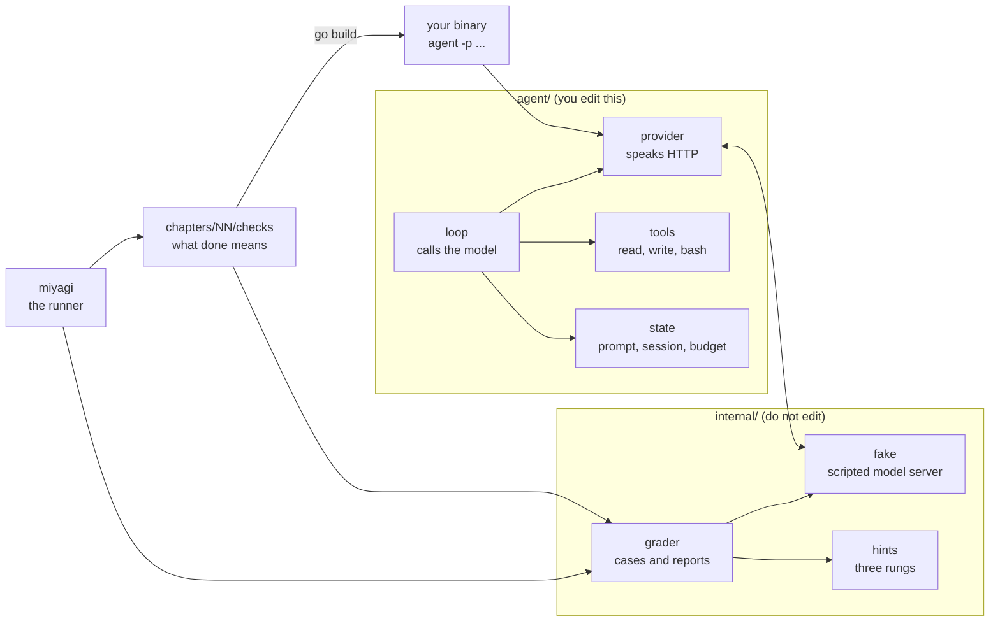
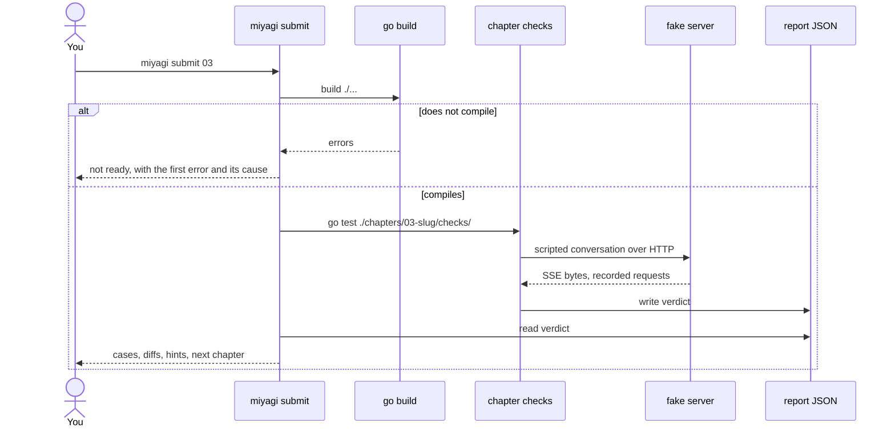
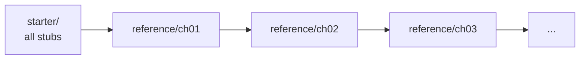
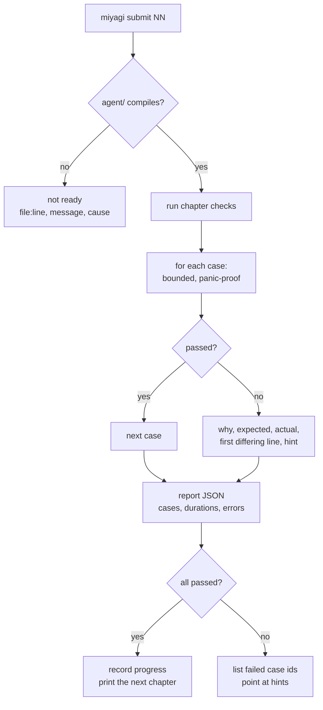

# Architecture

Miyagi has two halves. One is the agent you build in `agent/`. The other is the tool that
checks it. The tool builds your binary and runs it, so nothing reaches inside your code
and the internal design is yours.

`internal/fake` is a real HTTP server. It binds a socket, reads your request, checks your
headers, and writes Server-Sent Events with real chunk boundaries. Only the words in the
reply are fixed. When you point the same client at Ollama, nothing changes but the address.

## Repository layout

| Path | Role |
|---|---|
| `agent/` | The agent you build. The only directory a learner edits. |
| `starter/` | The state of `agent/` before chapter 01. Used to grade chapter 01 and by `miyagi reset`. |
| `reference/chNN/` | Only the files chapter NN changes. Applied in order. |
| `chapters/NN-slug/` | `README.md` (task, mechanism, checks, hints), `example.md` (the finished code), `checks/`, `title`. |
| `internal/fake/` | Scripted OpenAI-compatible server, and a scripted MCP server. |
| `internal/blackbox/` | Builds your binary and runs it, so checks see a program and not a package. |
| `internal/grader/` | Cases, bounded execution, the report, the diff. |
| `internal/hints/` | Three hints per case, keyed by chapter and case id. |
| `cmd/miyagi/` | The CLI: `submit`, `read`, `hint`, `list`, `progress`, `verify`, `reset`, `site`, `ui`, `watch`, `doctor`. |
| `docs/` | Architecture, chapter format, writing style, and how other harnesses are built. |

## A submit run

A build error is reported as "not ready", never as failed cases. Someone who mistyped an
import has not got the logic wrong, and the two failures need different responses.

## How chapters relate

Chapters are cumulative. Chapter NN's code contains everything chapter NN-1 established.
That is what makes "your earlier chapters stay green" a fact rather than a hope.

The state before chapter NN is derived by applying `reference/ch01` through
`reference/chNN-1`. Nothing is stored, so nothing can drift. `reference/chNN` holds only
the files that chapter changes: chapter 14 ships one file, chapter 10 ships one.

`miyagi verify` grades every chapter twice: once against its after state, which must pass,
and once against its before state, which must fail at least one case. A chapter whose
starter passes grades nothing. A chapter whose reference fails cannot be completed. Both
are caught offline, and both have happened during development.

## The grading pipeline

Every case runs with a timeout and a panic barrier. A program that blocks costs one case,
with its name attached, rather than the whole chapter.

## The interfaces

Four interfaces carry the agent, and each exists because a later chapter needed it.

| Interface | Where | What it allows |
|---|---|---|
| `Provider` | `agent/types.go` | one method, `Chat`. The interface the checks use. |
| `StreamingProvider` | `agent/loop.go` | `Provider` plus `Stream`, so a caller can see text as it arrives |
| `Tool` | `agent/types.go` | a name, a description, a schema, and `Execute` |
| `Contributor` | `agent/prompt.go` | a section for the system prompt, so skills and `AGENTS.md` do not edit the builder |
| `Recorder` | `agent/session.go` | append and load a conversation, so the loop does not know about files |

Two properties matter more than the list.

**The interfaces are narrow on purpose.** `Provider` has one method. Streaming was added by
declaring a wider interface beside it, so a provider that cannot stream is still a provider
and chapters 01 to 03 keep compiling.

**Production harnesses do not define most of these.** pi and PiG use concrete session
types rather than a session interface. crush exposes services instead of a registry. These
are interfaces for teaching: they keep the chapters additive and they let a check swap in a
scripted implementation.

Where to read the real thing, by concern:

| Concern | Read | Not |
|---|---|---|
| the loop, event order, tool batching | PiG `agent/agent_loop.go` | crush, whose loop lives in `charm.land/fantasy` |
| permission policy as a first-class service | crush `internal/permission/` | pi or PiG, which expose hooks only |
| MCP over stdio, hand-rolled | PiG and pi MCP clients | crush, which uses the official Go SDK |
| provider adapters | pi `packages/ai/src/api/` | none |

## Grading policy

Two drivers, one rule: grade the largest thing that can carry the claim.

| Claim | Driver | Why |
|---|---|---|
| the program answers a prompt | black box | only a process proves it is an application |
| the program runs a tool and continues | black box | the loop, the registry and the wire all participate |
| the session resumes with prior turns | black box | needs a real process, a real file, a second run |
| the request stays under the budget | black box | inspect the third request the program sent |
| this pure transform is correct | function | no process needed, and the diff is more precise |
| all 40 combinations of chunk boundaries | function | 40 processes buys no realism |

The course uses black box almost everywhere. Every chapter's checks build the binary and
run it.

## Determinism

| Layer | Faked | Proves |
|---|---|---|
| Process | nothing: your binary runs for real | the program works when invoked |
| Transport | HTTP server speaking SSE | your wire code is correct |
| Behaviour | scripted model decisions | your loop, tools and context logic |
| Output | full request traces, per case | nothing drifted silently |

No layer proves the agent is *good*. Quality needs a real model, money and judgement. Miyagi
grades whether the harness is correct, and says so.

## Adding a chapter

1. `chapters/NN-slug/` with `README.md`, `example.md`, `title` and `checks/chNN_test.go`.
2. `internal/hints/hints.go` gets an `"NN"` entry with three hints per case. The
   completeness test fails on a case with no ladder, or a ladder with no case.
3. `reference/chNN/` with only the files the chapter changes.
4. `miyagi verify` clean. Nothing else in the repository needs editing: the chapter list, the
   site sidebar, the part grouping and the grading order all come from the directory names.

## Glossary

| Term | Meaning |
|---|---|
| Harness | The code around a model that turns text into actions: provider, tools, loop, state. |
| Interface | A small set of methods you can swap for another implementation. |
| Scripted model | A fixture that replays a fixed reply. Not a mock of your code. |
| Case | One graded assertion with an id, a reason, and three hints. |
| Before state | The harness with chapters NN and later removed. |
| After state | The harness with chapters 01 through NN applied. |
