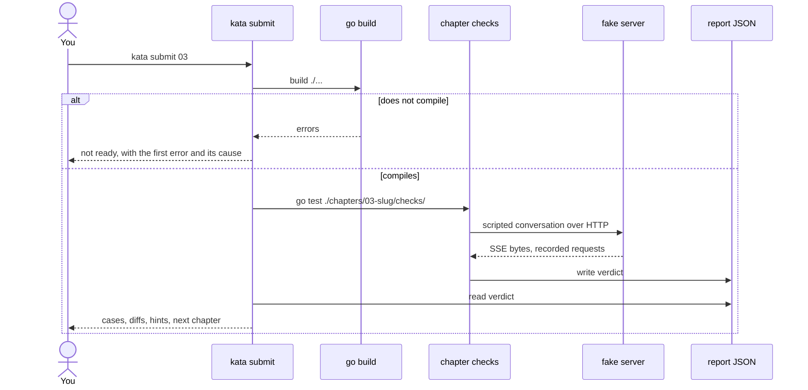
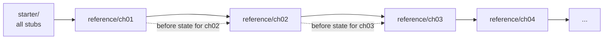
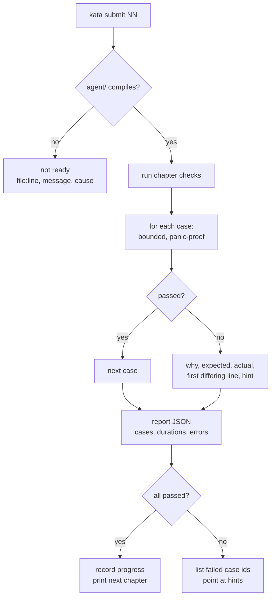
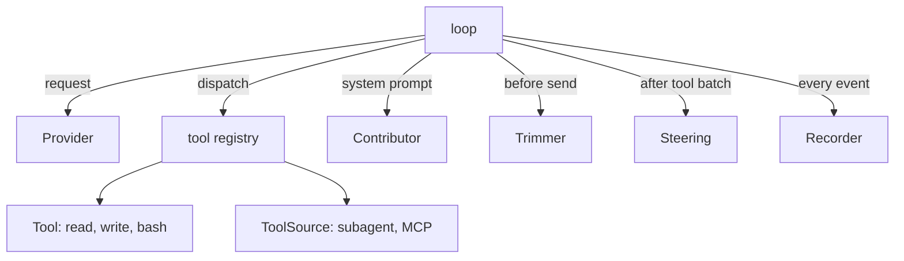

# Architecture

Kata has two halves. One is the application you build. The other is the tool that
checks it. The checks build your binary and run it, so nothing reaches inside your
code and your internal design is yours.


The fake server is a real HTTP server. It binds a socket, parses your request,
checks your headers, and writes Server-Sent Events with real chunk boundaries.
Only the content of the reply is scripted. That is the whole design: replace the
model, keep the wire.

## Repository layout

| Path | Role |
|---|---|
| `agent/` | The agent you build. The only directory a learner edits. |
| `starter/` | The initial state of `agent/`. Used to grade chapter 01 and by `kata reset`. |
| `reference/chNN/` | Overlay of the files as they must be after chapter NN. |
| `chapters/NN-slug/` | `README.md`, `overview.md`, `problem.md`, `example.md`, `checks/`. |
| `internal/fake/` | Scripted OpenAI-compatible server. The far side of the seam. |
| `internal/grader/` | Case DSL, bounded execution, report, diffs. |
| `internal/hints/` | The three-rung hint ladder, keyed by chapter and case. |
| `cmd/kata/` | The CLI: `submit`, `read`, `hint`, `list`, `progress`, `verify`, `reset`. |
| `docs/` | Architecture, chapter format, writing style. |

## A submit run



A build error is reported as "not ready". It never counts as a failed case,
because a learner who mistyped an import has not got the logic wrong.

## How chapters relate

Chapters are cumulative. Chapter NN's code is a subset of chapter NN+1's. That
property is what makes "your earlier chapters stay green" a guarantee instead of
a hope.



The state before chapter NN is derived by applying `reference/ch01` through
`reference/chNN-1`. It is not stored, so it cannot drift.

`kata verify` grades every chapter twice: once against its after state, which
must pass, and once against its before state, which must fail at least one case.
A chapter whose starter passes grades nothing. A chapter whose reference fails
cannot be completed. Both are caught offline.

## The grading pipeline



Every case runs with a timeout and a panic barrier. A harness that blocks costs
one case with its name attached, not the whole chapter.

## The seams

The harness is built around six interfaces. Chapters 05 to 11 add implementations
of them; they do not rewrite the loop.

| Interface | Method | Implemented by |
|---|---|---|
| `Provider` | `Chat(ctx, Request) (Message, Usage, error)` | chapter 01, extended in 02 |
| `Tool` | `Name`, `Description`, `Schema`, `Execute` | chapter 03 |
| `Contributor` | `Contribute(ctx) (string, error)`, appended to the system prompt | chapter 05 (context files), 09 (skill catalogue) |
| `Trimmer` | `Fit([]Message, budget) ([]Message, error)` | chapter 07 |
| `Steering` | `Drain() []Message`, polled after each tool batch | chapter 08 |
| `Recorder` | `Append(Event) error`, `Load(id) ([]Message, error)` | chapter 06 |
| `ToolSource` | `Tools(ctx) ([]Tool, error)`, merged into the registry | chapter 11 (subagent), 12 (MCP) |



A change that makes a later chapter edit `loop.go` is a design error, not a
scheduling problem. The seams exist so the course stays additive.

Two honest notes about these interfaces.

**Production harnesses do not define most of them.** pi and PiG use concrete
session types, not a session interface. crush exposes services
(`session.Service`, `message.Service`) rather than a registry. The interfaces
here are teaching seams, chosen so that chapters stay additive and so that a
check can substitute a scripted implementation. They are good design, not
doctrine.

**The provider seam is deliberately lossy.** `Chat` returns one finished message,
which hides the stream. That is the right compression for chapters 01 to 03.
Chapter 04 refactors the same parser into a `Stream` call that reports deltas as
they arrive, and keeps `Chat` as a thin collect-the-stream wrapper. Nothing about
the wire changes; only what the caller can see while it arrives.

Where to read the real thing, by concern:

| Concern | Read | Not |
|---|---|---|
| the loop, event order, tool batching | PiG `agent/agent_loop.go` | crush, whose loop lives in `charm.land/fantasy` |
| permission policy as a first-class service | crush `internal/permission/` | pi or PiG, which expose hooks only |
| MCP over stdio, hand-rolled | PiG/pi MCP clients | crush, which uses the official Go SDK |
| provider adapters | pi `packages/ai/src/api/` | — |

## Grading policy

Two drivers, one rule. Grade the largest thing that can carry the claim.

| Claim type | Driver | Why |
|---|---|---|
| "the program answers a prompt" | black box | only the process proves it is an application |
| "the program runs a tool and continues" | black box | the loop, the registry and the wire all participate |
| "the session resumes with prior turns" | black box | needs a real process, a real file, a second run |
| "the request stays under the budget" | black box | inspect the third request the program sent |
| "this pure transform is correct" | function | no process needed, and the diff is far more precise |
| "all 40 combinations of chunk boundaries" | function | one process per split is 40 processes for no realism |

Black box is the default. It is the only driver that can prove the thing you
built runs, and it leaves the internal design free.

Function level is the exception, and it needs a pinned surface: a small exported
function whose signature the chapter states up front. Two rules keep it honest:

1. The pinned surface is the smallest possible type. If a `[]Message` in and
   `[]Message` out can express it, do not pin anything larger.
2. A pinned function is a contract, not an architecture. The chapter says what
   it must do, never how it is built.

A chapter that mixes the two declares both, case by case:

```
checks/ch07_test.go
  budget-ceiling      black box   run the program, inspect request 3
  budget-orphans      black box   inspect every request for unpaired calls
  estimate-tokens     function    EstimateTokens, pinned in agent/contract.go
```

Neither driver is allowed to weaken the other. A black-box case never asserts on
a log line the program could fake, and a function case never stands in for a
behaviour a user would notice.

## Determinism

| Layer | Faked | Proves |
|---|---|---|
| Process | nothing: your binary runs for real | the program works when invoked |
| Transport | HTTP server speaking SSE | your wire code is correct |
| Behaviour | scripted model decisions | your loop, tools, and context logic |
| Output | full request traces, per case | nothing drifted silently |

There is no layer that proves the agent is good. Quality needs a real model,
money, and judgement. Kata grades correctness of the harness, and says so.

## Adding a chapter

1. `chapters/NN-slug/checks/chNN_test.go` with cases in the `grader.Suite` DSL.
2. `internal/hints/hints.go` entries, three rungs each. The completeness test
   fails if a case has no ladder or a ladder has no case.
3. `reference/chNN/` with only the files this chapter changes.
4. `overview.md`, `problem.md`, `example.md`, `README.md`.
5. `kata verify`. It must be clean before the chapter counts as written.

## Glossary

| Term | Meaning |
|---|---|
| Harness | The code around a model that turns text into actions: provider, tools, loop, state. |
| Seam | An interface you can replace. The provider seam is the one the grader uses. |
| Scripted model | A fixture that replays a fixed reply. Not a mock of your code. |
| Case | One graded assertion with an id, a reason, and three hint rungs. |
| Before state | The harness with chapters NN and later removed. |
| After state | The harness with chapters 01 through NN applied. |
